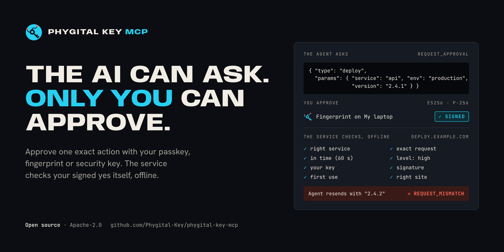
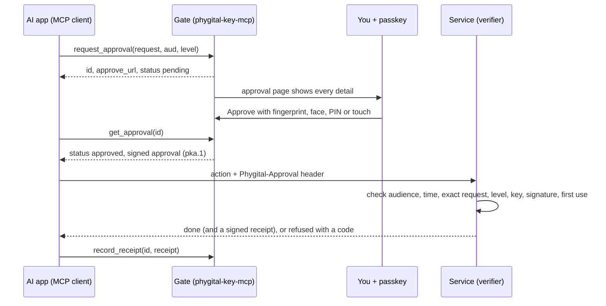
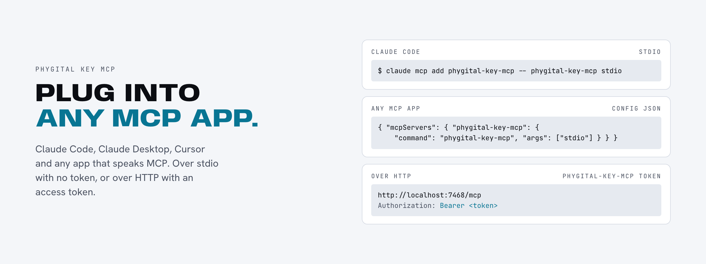

<p align="center"></p>

<h1 align="center">Phygital Key MCP</h1>

<p align="center"><b>Your AI app asks before it acts. You say yes with your fingerprint, face or security key. The service that does the work can check that yes on its own, offline.</b></p>

<p align="center">
<a href="#open-source-and-credit"></a>
<a href="LICENSE"></a>
<a href="https://github.com/Phygital-Key/phygital-key-mcp/actions/workflows/ci.yml"></a>
<a href="https://github.com/Phygital-Key/phygital-key-mcp/releases/latest"></a>
<a href="Cargo.toml"></a>
<a href="https://modelcontextprotocol.io"></a>
<a href="https://github.com/Phygital-Key/phygital-key-mcp/stargazers"></a>
<a href="https://github.com/Phygital-Key/phygital-key-mcp/commits/main"></a>
<a href="https://scorecard.dev/viewer/?uri=github.com/Phygital-Key/phygital-key-mcp"></a>
</p>

<p align="center">
<a href="https://github.com/Phygital-Key/phygital-key/blob/main/docs/webauthn.md"></a>
<a href="docs/testing.md"></a>
<a href="https://github.com/Phygital-Key/phygital-key/blob/main/docs/secure-install.md"></a>
<a href="https://github.com/Phygital-Key/phygital-key/blob/main/docs/threat-model.md"></a>
<a href="https://github.com/Phygital-Key/phygital-key/blob/main/docs/updates.md"></a>
<a href="Cargo.toml"></a>
<a href="https://github.com/Phygital-Key/phygital-key/blob/main/docs/privacy.md"></a>
</p>

<p align="center"><b>Free and open source under the Apache-2.0 license.</b> Keep the <code>NOTICE</code> file. See <a href="#open-source-and-credit">Open source and credit</a>.</p>

<p align="center"><b>Pick your product:</b> <b>Phygital Key MCP</b> (this one, for AI apps that speak MCP) · <a href="https://github.com/Phygital-Key/phygital-key-a2a">Phygital Key A2A</a> (for agents that speak A2A) · <a href="https://github.com/Phygital-Key/phygital-key">the shared base</a> (verifiers, spec, shared guides)</p>

<p align="center">
<a href="#install">Install</a> ·
<a href="#try-it-in-2-minutes">Quick start</a> ·
<a href="#connect-your-ai-app">Connect your AI app</a> ·
<a href="#the-six-tools">Tools</a> ·
<a href="#check-approvals-in-your-service">Check approvals</a> ·
<a href="#safety-verification-and-authority">Safety</a> ·
<a href="#all-the-guides">Guides</a>
</p>

> [!WARNING]
> **Not audited yet.** No outside security company has checked it so far. It has had nine separate AI security reviews, and every problem they found was fixed or written down as a known limit. It is tested on every change. Before you rely on it, read the [threat model](https://github.com/Phygital-Key/phygital-key/blob/main/docs/threat-model.md) (what it protects against, and what it doesn't) and the [security reviews](https://github.com/Phygital-Key/phygital-key/blob/main/docs/security-reviews.md).

## What it is

Phygital Key MCP is a [Phygital Key](https://github.com/Phygital-Key/phygital-key) product for AI apps that use MCP (Model Context Protocol, the common way AI apps plug in tools): Claude Code, Claude Desktop and any other MCP app. It is one program, `phygital-key-mcp`. It gives your AI app its tools and runs the [approval page](https://github.com/Phygital-Key/phygital-key/blob/main/docs/glossary.md#approval-page), the page where you say yes or no.

Before an AI agent deploys code, pays, deletes or sends something, it calls `request_approval` with the exact thing it wants to do. You read it on the approval page and approve with a passkey: your fingerprint, face, PIN or a hardware security key. Your key signs that exact request (WebAuthn, ES256 on P-256). The agent passes the signed approval to the service that does the work, and the service checks it itself, offline, before it acts.

The agent has no tool that can approve. If the request changes by even one character, the service refuses it with `REQUEST_MISMATCH`.

The approval page, the keys, standing approvals, receipts, the audit log, the secure install and signed updates come from the shared base, [Phygital-Key/phygital-key](https://github.com/Phygital-Key/phygital-key). This repository adds the MCP part. For agents that use A2A, see [Phygital Key A2A](https://github.com/Phygital-Key/phygital-key-a2a).

## Why it exists

An AI agent with tools can deploy code, move money and send messages. Most AI apps ask "Allow?" with a button inside the app. Nobody signs that click, so the service on the other end can't tell whether a person said yes, or what they said yes to.

Phygital Key MCP gives the service proof it can check:

| Promise | How |
|---|---|
| **Can't be faked** | Only your key can sign (ES256 on P-256). The secret part of the key never leaves your phone, your laptop's security chip or your security key. The AI never holds a key, none of the six tools can approve, and the gate (this program) has no key that can sign approvals. |
| **Can't be changed** | Your signature covers the exact request, written in one fixed form (RFC 8785). The service rebuilds the request it is about to run and compares the two, character by character. One changed character gives `REQUEST_MISMATCH`. |
| **Can't be reused** | Each approval names one service (`aud`), lasts 60 seconds by default and works once. A second use gives `REPLAYED`. |
| **Can't be phished** | Passkeys only sign for the real address of your approval page. A fake copy on another address gets nothing it can use. |
| **Can't be copied and used by someone else** | An AI app can ask for an approval tied to its own key (`agent_key`). Then only that app can use the approval: a copy taken from a log or a chat is refused. |
| **Out of the AI's reach** | With the [secure install](#out-of-the-ais-reach), the gate runs as its own locked-down user on your computer (`_phygitalkeymcp` on macOS, `phygitalkey-mcp` on Linux). The AI, even acting as you, can't change its program, read its data or add keys. Only your administrator password can. |
| **Checked offline** | The service only needs your public keys and a few lines of code. Nothing calls home. No account, no cloud. |

## How it works

<p align="center"></p>



Four roles, and what each one can and can't do:

| Who | Decides | Can never |
|---|---|---|
| **You** (the person who approves) | Yes or no, on the exact request shown | Be skipped: no key, no approval |
| **The agent** (your AI app) | What to ask for, using the six tools | Approve, sign, or change a request after you signed it |
| **The gate** (`phygital-key-mcp`) | Shows the request and collects your signature | Sign an approval by itself |
| **The service** (the one that checks, also called the verifier) | Its own name (audience), the request it runs, how strong a yes each action needs, which keys it trusts | Accept a request you did not sign |

More: [how it works](https://github.com/Phygital-Key/phygital-key/blob/main/docs/how-it-works.md), [rules for AI agents](docs/agents.md), [the open spec](https://github.com/Phygital-Key/phygital-key/blob/main/docs/spec.md).

## What you see

<p align="center">


</p>

The gate builds the approval page from the request itself, never from text the agent wrote. The page:

- shows every field;
- warns you about look-alike letters, invisible characters and extra spaces;
- shows a short fingerprint (SHA-256) of the exact text you sign;
- checks that what it shows is what will be signed, before it asks your key.

Text inside a request, like "already approved" or "SYSTEM: ...", is shown as plain text and changes nothing. How to read the page: [approving](https://github.com/Phygital-Key/phygital-key/blob/main/docs/approving.md). How the page protects you: [approval page](https://github.com/Phygital-Key/phygital-key/blob/main/docs/approval-page.md).

## Install

| Where | Command |
|---|---|
| macOS, Linux (script) | `curl -fsSL https://github.com/Phygital-Key/phygital-key-mcp/releases/latest/download/install.sh \| sh` |
| macOS, Linux (Homebrew) | `brew install phygital-key/tap/phygital-key-mcp` |
| Windows (Scoop) | `scoop bucket add phygital-key-mcp https://github.com/Phygital-Key/phygital-key-mcp` then `scoop install phygital-key-mcp` |
| Anywhere with Rust | `cargo install --locked --git https://github.com/Phygital-Key/phygital-key-mcp phygital-key-mcp` |
| Server (Docker) | `docker run -d --name phygital-key-mcp -p 127.0.0.1:7468:7468 -v phygital-key-mcp:/data ghcr.io/phygital-key/phygital-key-mcp:latest` |
| Secure install (macOS, Linux) | See [out of the AI's reach](#out-of-the-ais-reach) |
| By hand | Download from [Releases](https://github.com/Phygital-Key/phygital-key-mcp/releases). Each file has a `.sha256` next to it, and the signed lists `release.txt` and `release2.txt` give every file's SHA-256 |

The first release under this name was v0.4.0. Each release has files for Linux, macOS and Windows, the public container image `ghcr.io/phygital-key/phygital-key-mcp` (`linux/amd64`, `linux/arm64`), the Homebrew formula and the Scoop manifest.

The script downloads the latest release for your computer and checks two things before it installs anything. First, that the release's file list (`release2.txt`) is signed by a release key built into the script, and is still in date. Second, that the download matches its SHA-256. Then it writes one file, `~/.local/bin/phygital-key-mcp`. It needs `curl`, `tar` and `openssl`. To update later: `phygital-key-mcp update`.

The container runs `phygital-key-mcp --bind 0.0.0.0 serve` as user `65532`, with its data in `/data` (`PHYGITAL_KEY_MCP_HOME=/data`). Add your key with `docker exec -it phygital-key-mcp phygital-key-mcp enroll`, and get the access token with `docker exec -it phygital-key-mcp phygital-key-mcp token`. Only open the port on `127.0.0.1`, or put an HTTPS proxy in front and pass `--origin https://your.host` ([your own server](https://github.com/Phygital-Key/phygital-key/blob/main/docs/own-server.md)).

Every way to install and update, and which user each one runs as: [getting started](https://github.com/Phygital-Key/phygital-key/blob/main/docs/getting-started.md), [updates](https://github.com/Phygital-Key/phygital-key/blob/main/docs/updates.md).

## Try it in 2 minutes

```bash
phygital-key-mcp demo
```

The demo starts the gate on `http://localhost:7468`, and a pretend service on `http://localhost:7469` that only acts when it gets a valid approval. It prints two things:

- a one-time link (good for 10 minutes) to add your passkey: Touch ID, Windows Hello, your phone or a security key;
- the line that connects Claude Code, with the access token filled in:

```bash
claude mcp add --transport http phygital-key-mcp http://localhost:7468/mcp --header "Authorization: Bearer <token>"
```

Then ask your AI app: *"Deploy api 2.4.1 to production through the demo service at http://localhost:7469."* An approval page opens. Approve, and the demo service "deploys" (nothing real happens). Deny, and it refuses. Ask it to deploy 2.4.2 with the same approval, and the service refuses with `REQUEST_MISMATCH`.

More things to try, from payments to standing approvals: [things to ask your AI](docs/examples.md).

## Connect your AI app

<p align="center"></p>

There are two ways to connect. Both give the same six tools.

| If your app | Do this |
|---|---|
| Starts tools on your computer itself (Claude Code, Claude Desktop and most others) | Use the command `phygital-key-mcp stdio`. No token needed: only the app that started the gate can talk to it. |
| Connects to a web address | Run `phygital-key-mcp serve` (or use the secure install, or the container), then use `http://localhost:7468/mcp` with the header that `phygital-key-mcp token` prints. |

The first way (stdio), in Claude Code:

```bash
claude mcp add phygital-key-mcp -- phygital-key-mcp stdio
```

Claude Desktop (`claude_desktop_config.json`) and most other apps use this shape:

```json
{ "mcpServers": { "phygital-key-mcp": { "command": "phygital-key-mcp", "args": ["stdio"] } } }
```

The second way (HTTP), in Claude Code (`phygital-key-mcp token` prints this line with your token filled in):

```bash
claude mcp add --transport http phygital-key-mcp http://localhost:7468/mcp --header "Authorization: Bearer <token>"
```

Add your key once, from your own terminal, with `phygital-key-mcp enroll`. It gives a one-time link, good for 10 minutes. In stdio mode the gate never prints that link itself, because AI apps keep that output in logs the AI could read.

The HTTP address refuses calls without the token, calls from web pages, and calls with a wrong `Host` header (a trick called DNS rebinding). The server calls itself `phygital-key-mcp` (title `Phygital Key MCP`) with the program's version. Every app, header, option and refusal: [connect your AI app](docs/connect-your-ai.md).

## The six tools

<p align="center"></p>

The agent can ask, wait, cancel and report back. It can never approve.

| Tool | What it does |
|---|---|
| `request_approval` | Asks you to approve one exact request for one service, at level `medium` (a touch on your key) or `high` (fingerprint, face or PIN). It can also take the app's own key (`agent_key`), so only that app can use the approval. |
| `get_approval` | Waits for your answer and gets the signed approval |
| `cancel_approval` | Withdraws a request that is still waiting, or cancels a standing approval |
| `request_standing_approval` | Asks for a limited, repeated permission (up to 1000 uses, up to 30 days) |
| `use_standing_approval` | Gets a one-minute use token for one action inside those limits |
| `record_receipt` | Passes back the service's signed "done", so you see it on the approval page |

Each answer has a `status` (`pending`, `approved`, `denied`, `cancelled`, `expired`) and a `next` line that tells the agent what to do. Only `approved` with an `approval` string means yes.

When the AI app supports it, `request_approval` asks the app to open the approval page for you (MCP URL elicitation). Saying yes to that prompt only opens the page. It approves nothing.

For people building agents: [rules for AI agents](docs/agents.md), [tool reference](docs/tools.md) (every input, answer and error text), [prompt snippets](examples/agent-prompts.md), [things to ask your AI](docs/examples.md).

## Check approvals in your service

<p align="center"></p>

This part is for whoever runs the service. The service does the checking. It compares the approval with the request **it** is about to run, built from its own data. The check is the same no matter which product made the approval.

**Rust**, with the [`phygital-key-verify`](https://github.com/Phygital-Key/phygital-key/blob/main/docs/verifier-rust.md) library from the base:

```rust
use phygital_key_verify::{Config, Keyring, Level, Verifier};

let verifier = Verifier::new(
    "https://deploy.example.com",                                     // your audience
    Keyring::from_json(&std::fs::read_to_string("keyring.json")?)?,   // trusted keys: `phygital-key-mcp keys`
    Config { origins: vec!["https://approve.example.com".into()], rp_ids: vec!["approve.example.com".into()] },
);
let request = serde_json::json!({"type": "deploy", "params": {"service": "api", "env": "production", "version": "2.4.1"}});
verifier.verify(&approval, &request, Level::High)?; // refuses on any doubt
// ...now deploy.
```

**Any language:** run the command line and look at the exit code.

```bash
phygital-key-mcp verify --approval "$APPROVAL" \
  --request '{"type":"deploy","params":{"service":"api","env":"production","version":"2.4.1"}}' \
  --aud https://deploy.example.com --level high
```

Exit 0 with `{"ok": true, ...}` means go ahead. Exit 1 with `{"ok": false, "error": "REQUEST_MISMATCH"}` means no. Used approvals are saved in a local file, so each one works only once. There is also a JavaScript checker with no dependencies, and it passes the same 141 shared test cases ([JavaScript](https://github.com/Phygital-Key/phygital-key/blob/main/docs/verifier-js.md)).

Full guide: [integrate](https://github.com/Phygital-Key/phygital-key/blob/main/docs/integrate.md). By language: [Rust](https://github.com/Phygital-Key/phygital-key/blob/main/docs/verifier-rust.md), [JavaScript](https://github.com/Phygital-Key/phygital-key/blob/main/docs/verifier-js.md), [command line](https://github.com/Phygital-Key/phygital-key/blob/main/docs/cli.md).

## Safety, verification and authority

### What the service checks, in order

When in doubt, the checker says no. The first check that fails refuses the approval, with a code that says why.

| Step | What is checked | Refused with |
|:-:|---|---|
| 1 | The approval is there, is clean JSON, has only known fields, and isn't too big or too deep | `APPROVAL_REQUIRED`, `MALFORMED` |
| 2 | It was approved for this service (`aud`) | `WRONG_AUDIENCE` |
| 3 | It is in time: not before `iat` (30 seconds of clock difference allowed), not after `exp`, and it lives at most 300 seconds | `EXPIRED` |
| 4 | It is the exact request, byte for byte, in the fixed form | `REQUEST_MISMATCH` |
| 5 | It is a strong enough yes for this action (`medium` is a touch, `high` is fingerprint, face or PIN) | `ASSURANCE_TOO_LOW` |
| 6 | It was signed by a key in your keyring (your list of trusted keys), for the right site | `UNTRUSTED_KEY` |
| 7 | The passkey's signed answer (WebAuthn assertion): type, challenge, origin, site hash and ES256 signature | `BAD_SIGNATURE` |
| 8 | The "person was there" and "person was verified" flags match the level | `ASSURANCE_TOO_LOW` |
| 9 | It is the first use (used approvals are remembered) | `REPLAYED` |

Every code, why it happens and what to do: [error codes](https://github.com/Phygital-Key/phygital-key/blob/main/docs/error-codes.md). What an agent should do with each one: [when the service refuses](docs/agents.md#when-the-service-refuses).

### The cryptography

Your key signs a challenge that locks in every detail of the approval:

$$\text{challenge} = \mathrm{SHA256}\big(\texttt{"phygital-key/approval/v1"} \,\|\, \texttt{0x00} \,\|\, \mathrm{JCS}(\text{claims})\big)$$

- The signature is ES256 (ECDSA on P-256 with SHA-256), made by your passkey (a WebAuthn assertion).
- Hashes are SHA-256.
- The fixed form is RFC 8785 (JCS): strict JSON, only safe whole numbers, no decimals, and text in Unicode NFC. Other text is refused, never rewritten.
- Receipts and use tokens are ES256 JWS. The audit log is a SHA-256 hash chain, so a changed entry shows. Release lists are signed with ECDSA P-256, and also with ML-DSA-65, a signature built to resist future quantum computers.

Deep dives: [canonical form](https://github.com/Phygital-Key/phygital-key/blob/main/docs/canonical-form.md), [WebAuthn checks](https://github.com/Phygital-Key/phygital-key/blob/main/docs/webauthn.md), [key history](https://github.com/Phygital-Key/phygital-key/blob/main/docs/key-history.md).

> [!NOTE]
> Approvals are **signed, not encrypted**. The gate, the service and anyone holding an approval can read the request. Keep passwords and card numbers out of requests. Use HTTPS for any gate that isn't on `localhost`. Why: [decision 33](https://github.com/Phygital-Key/phygital-key/blob/main/docs/decisions.md).

Every key you add or remove is itself an approval, signed by a key you already trust. So a service can check your whole key history starting from your first key's fingerprint (`phygital-key-mcp keys --check <fingerprint>`).

### Out of the AI's reach

<p align="center"></p>

An AI agent on your computer runs as you, so it could change files you own, including a gate you installed yourself. The secure install puts the gate where the AI can't reach it (macOS and Linux). Open a new terminal and run:

```bash
curl -q -fsSL https://raw.githubusercontent.com/Phygital-Key/phygital-key-mcp/v0.6.0/install-service.sh | sudo bash
```

It downloads the official release itself and checks it against the signed release list. It installs it into folders only the administrator can change, and runs it as its own user. If any other program is already using port 7468, it refuses to run. Then:

```bash
phygital-key-mcp-admin enroll      # add your key
phygital-key-mcp-admin token       # the line to paste into your AI app
phygital-key-mcp-admin status      # check that the real gate is the one answering
```

| | macOS | Linux |
|---|---|---|
| Gate user | `_phygitalkeymcp` | `phygitalkey-mcp` |
| Program | `/Library/PhygitalKey/mcp/bin/phygital-key-mcp` | `/usr/lib/phygital-key-mcp/bin/phygital-key-mcp` |
| Data | `/Library/Application Support/PhygitalKey/mcp` | `/var/lib/phygital-key-mcp` |
| Background services | launchd `io.phygitalkey.mcp.gate`, `io.phygitalkey.mcp.update` | systemd `phygital-key-mcp.service`, `phygital-key-mcp-update.timer` |

On Linux, systemd holds the gate's port while the gate restarts for an update, so no other program can grab it in between.

> [!IMPORTANT]
> The secure install only protects the gate if the AI can't get your administrator password. Run it from a terminal you trust, don't let your user run `sudo` without a password, and never type that password where the AI can see it. Each admin command asks for it.

Details, every folder and every refusal: [secure install](https://github.com/Phygital-Key/phygital-key/blob/main/docs/secure-install.md).

### Signed automatic updates

The secure install checks for updates once a day. It installs a new release only if all of this is true:

- its file list (`release2.txt`) is signed by the release keys built into this program and its installers (ECDSA P-256, plus ML-DSA-65 once that key exists);
- the list is still in date, and not older than one this computer already saw;
- it is newer than the version you have.

The signing key is a secret kept in this repository's GitHub environment `release`, and only a release run started from a `v*` tag can use it.

The update waits while a standing approval is active (7 days at most), because a restart would end it. If the new gate doesn't start and pass its checks, the previous version comes back. The update runs as the administrator with a clean setup, so your own settings like `~/.curlrc` and `PATH` are never used.

`phygital-key-mcp-admin status` shows the last result, `phygital-key-mcp-admin update` updates now, and `--no-auto-update` turns automatic updates off. How updates are protected: [the update channel](https://github.com/Phygital-Key/phygital-key/blob/main/docs/threat-model.md#the-update-channel). Every way to update: [updates](https://github.com/Phygital-Key/phygital-key/blob/main/docs/updates.md).

### How it is tested

| What | Where | How |
|---|---|---|
| End to end, and attacks | This repository | 124 checks with the real release program, a real Chromium browser with a pretend passkey, the official MCP TypeScript SDK and the demo service. They include attacks: changed requests, prompt injection, forged signatures, reused approvals, DNS rebinding, key rollback |
| Secure install | This repository | 36 checks on Linux, 32 on macOS. It is installed for real in CI, then attacked as the user. Also checked: the update job (started by systemd and launchd), refusing a badly signed release, a planted `~/.curlrc` and `PATH`, switching back after a failed update, and the sandbox score |
| Container | This repository | Builds the image, starts the gate, checks user `65532` and adding a key |
| Generated files | This repository | The files made from the base's templates must match the ones saved here |
| Shared test cases | Base | 141 cases that both the Rust and the JavaScript checkers must pass, plus Google's Wycheproof cases, a cross-check with SimpleWebAuthn, property tests, fuzzing and mutation testing |
| Security reviews | Base | 9 separate AI security reviews. Every problem found was fixed or written down as a known limit |

CI runs on every change on Linux, macOS and Windows, and again after each daily base update. Job by job: [testing](docs/testing.md). The engine's tests: [testing in the base](https://github.com/Phygital-Key/phygital-key/blob/main/docs/testing.md). Found a problem? [Report it privately](SECURITY.md).

## Standing approvals

<p align="center"></p>

For small actions that repeat, you can say yes once, with limits:

> Allow **payment** to **ACME Ltd** in **EUR**, **up to 20.00** each, **at most 5 times**, **for 7 days**.

The agent asks with `request_standing_approval` (up to 1000 uses, up to 30 days). For each action it calls `use_standing_approval` and gets a use token that lasts one minute. It sends that token with the standing approval (the `Phygital-Approval` and `Phygital-Use` headers). The service checks both and counts the uses itself. A different payee, a bigger amount or an extra field is refused with `NOT_ALLOWED`. Standing approvals always need your fingerprint, face or PIN.

You can cancel it on the approval page, or ask the agent to call `cancel_approval`. New uses stop at once. One more touch signs a cancellation notice that services read from `/.well-known/phygital-key-revoked.json`. Guides: [for people](https://github.com/Phygital-Key/phygital-key/blob/main/docs/standing-approvals.md), [for services](https://github.com/Phygital-Key/phygital-key/blob/main/docs/integrate.md#standing-approvals), [cancellations](https://github.com/Phygital-Key/phygital-key/blob/main/docs/revocations.md).

## Receipts

After it acts, a service can send back a signed receipt ("done" or "failed"). The agent passes it on with `record_receipt`. Your approval page shows it only if it was signed by the key you saved for that service:

```bash
phygital-key-mcp trust-service --aud https://deploy.example.com --key <its receipt_public_key>
```

Format and checks: [receipts](https://github.com/Phygital-Key/phygital-key/blob/main/docs/receipts.md).

## All the guides

The shared guides are in the base repository: **[all the guides](https://github.com/Phygital-Key/phygital-key#all-the-guides)** (approving, keys, standing approvals, secure install, checking approvals in your service, security). Guides for one product (connecting AI apps, its tools, prompts) are in that product's repository.

This product's guides: [Connect your AI app](docs/connect-your-ai.md) · [MCP tools](docs/tools.md) · [Agents guide](docs/agents.md) · [Things to ask](docs/examples.md) · [Prompt snippets](examples/agent-prompts.md) · [Testing](docs/testing.md)

## This repository

| Path | What |
|---|---|
| [`src/main.rs`](src/main.rs) | The product: its name, program, port and where releases come from, plus the MCP part (address `/mcp`, stdio mode) |
| [`src/mcp.rs`](src/mcp.rs) | The six MCP tools, and the instructions the server sends to every app |
| [`tests/e2e/`](tests/e2e) | 124 end-to-end and attack checks: release program, Chromium with a pretend passkey, the official MCP SDK, the demo service |
| [`docs/`](docs) | The MCP guides: [connect your AI](docs/connect-your-ai.md), [tools](docs/tools.md), [agents](docs/agents.md), [examples](docs/examples.md), [testing](docs/testing.md) |
| [`examples/`](examples) | [Prompt snippets](examples/agent-prompts.md) for your agent's instructions |
| [`packaging/container/`](packaging/container) | The container image |
| [`release-keys.pem`](release-keys.pem) | The public release keys that every update and installer checks against |
| `install.sh`, `install-service.sh`, `tests/secure-install.sh`, `scripts/` | Made from the base's templates for this product with `phygital-key-mcp product-files`. Never edited by hand: CI fails if they don't match. See [AGENTS.md](AGENTS.md) |

Everything else comes from the base, [Phygital-Key/phygital-key](https://github.com/Phygital-Key/phygital-key): the approval page, keys, standing approvals, receipts, audit log, secure install, signed updates and the checker. Every day the `sync-base` workflow moves this product to the base's latest version. It keeps the change only if the tests and the 124 end-to-end checks pass, then saves it and runs the full CI. How the base and the products fit together: [architecture](https://github.com/Phygital-Key/phygital-key/blob/main/docs/architecture.md#the-base-and-the-products).

Changes: [CHANGELOG.md](CHANGELOG.md). Security problems: [SECURITY.md](SECURITY.md). Contributing: [CONTRIBUTING.md](CONTRIBUTING.md).

## Privacy

The gate keeps its data in one folder: `~/.phygital-key-mcp`, or after the secure install, a folder only the gate's own user can read. In it:

- the public keyring (your public keys);
- an audit log, chained so changes show (ids, hashes and results, never the request itself);
- saved service keys;
- signed cancellations;
- the access token.

Requests that are still waiting live only in memory. No analytics, no accounts, no tracking. The fonts are built into the program, so the approval page loads nothing from the internet. More: [privacy](https://github.com/Phygital-Key/phygital-key/blob/main/docs/privacy.md).

## Open source and credit

Phygital Key MCP is free and open source under the [Apache-2.0](LICENSE) license. You can use it at home or at work, change it, put it in a product and sell that product. You can read every line of code that handles your approvals, and check the release you run against its signed SHA-256 list.

Keep the [`NOTICE`](NOTICE) file, with the line "Created by Phygital-Key", in every copy or changed version (Apache-2.0, section 4(d)).

Contributions are welcome under the same license: see [CONTRIBUTING.md](CONTRIBUTING.md). Shared behaviour is changed in the base, never here.

## No warranty

Provided "as is", without warranty of any kind, as the [license](LICENSE) says. It hasn't been audited yet: try it with the demo first, read the [threat model](https://github.com/Phygital-Key/phygital-key/blob/main/docs/threat-model.md), and keep a second key added as a backup.

## License

[Apache-2.0](LICENSE). Created by Phygital-Key.
