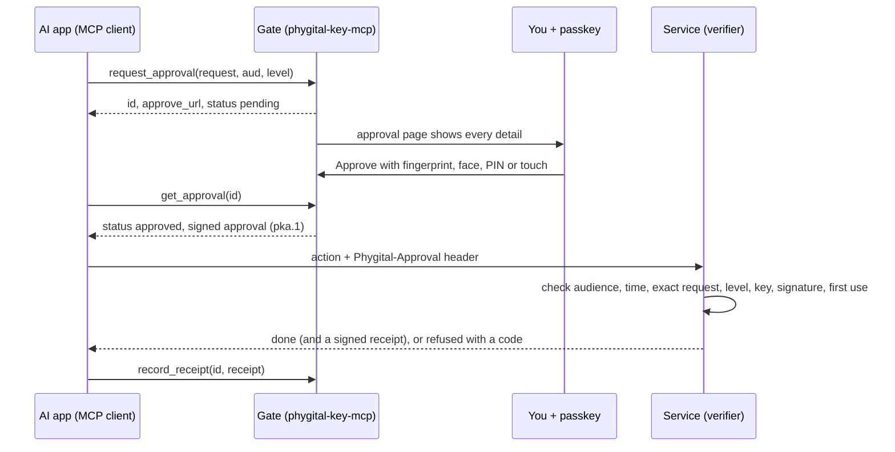

<p align="center"></p>

<h1 align="center">Phygital Key MCP</h1>

<p align="center"><b>Your AI app asks through MCP. You approve the exact action with your passkey. The service checks your signed yes itself, offline.</b></p>

<p align="center">
<a href="#open-source-and-credit"></a>
<a href="LICENSE"></a>
<a href="https://github.com/Phygital-Key/phygital-key-mcp/actions/workflows/ci.yml"></a>
<a href="https://github.com/Phygital-Key/phygital-key-mcp/releases/latest"></a>
<a href="Cargo.toml"></a>
<a href="https://modelcontextprotocol.io"></a>
<a href="https://github.com/Phygital-Key/phygital-key-mcp/stargazers"></a>
<a href="https://github.com/Phygital-Key/phygital-key-mcp/commits/main"></a>
<a href="https://scorecard.dev/viewer/?uri=github.com/Phygital-Key/phygital-key-mcp"></a>
</p>

<p align="center">
<a href="https://github.com/Phygital-Key/phygital-key/blob/main/docs/webauthn.md"></a>
<a href="docs/testing.md"></a>
<a href="https://github.com/Phygital-Key/phygital-key/blob/main/docs/secure-install.md"></a>
<a href="https://github.com/Phygital-Key/phygital-key/blob/main/docs/threat-model.md"></a>
<a href="https://github.com/Phygital-Key/phygital-key/blob/main/docs/updates.md"></a>
<a href="Cargo.toml"></a>
<a href="https://github.com/Phygital-Key/phygital-key/blob/main/docs/privacy.md"></a>
</p>

<p align="center"><b>Free and open source under the Apache-2.0 license.</b> Keep the <code>NOTICE</code> file. See <a href="#open-source-and-credit">Open source and credit</a>.</p>

<p align="center"><b>Pick your product:</b> <b>Phygital Key MCP</b> (this one, for AI apps that speak MCP) · <a href="https://github.com/Phygital-Key/phygital-key-a2a">Phygital Key A2A</a> (for agents that speak A2A) · <a href="https://github.com/Phygital-Key/phygital-key">the shared base</a> (verifiers, spec, shared guides)</p>

<p align="center">
<a href="#install">Install</a> ·
<a href="#try-it-in-2-minutes">Quick start</a> ·
<a href="#connect-your-ai-app">Connect your AI app</a> ·
<a href="#the-six-tools">Tools</a> ·
<a href="#check-approvals-in-your-service">Check approvals</a> ·
<a href="#safety-verification-and-authority">Safety</a> ·
<a href="#all-the-guides">Guides</a>
</p>

> [!WARNING]
> **Pre-audit.** No outside security firm has reviewed it yet. It has had nine independent AI security reviews with every finding fixed or documented as a limit, and it is tested on every change. Read the [threat model](https://github.com/Phygital-Key/phygital-key/blob/main/docs/threat-model.md) and the [security reviews](https://github.com/Phygital-Key/phygital-key/blob/main/docs/security-reviews.md) before you rely on it.

## What it is

Phygital Key MCP is a [Phygital Key](https://github.com/Phygital-Key/phygital-key) product for AI apps that speak MCP (Model Context Protocol): Claude Code, Claude Desktop and any other MCP client. It is one program, `phygital-key-mcp`, that runs the MCP server and the [approval page](https://github.com/Phygital-Key/phygital-key/blob/main/docs/glossary.md#approval-page).

Before an AI agent deploys, pays, deletes or sends, it calls `request_approval` with the exact request. You read that request on the approval page and approve it with a passkey, fingerprint, face, PIN or hardware key. Your key signs the exact request (WebAuthn, ES256 on P-256). The agent hands the signed approval to the service, and the service checks it itself, offline, before it acts. The agent has no tool that can approve, and a request changed by one character is refused with `REQUEST_MISMATCH`.

The approval page, the keys, standing approvals, receipts, the audit log, the secure install and signed updates come from the shared base, [Phygital-Key/phygital-key](https://github.com/Phygital-Key/phygital-key). This repository adds the MCP side. For agents that speak A2A, see [Phygital Key A2A](https://github.com/Phygital-Key/phygital-key-a2a).

## Why it exists

An AI agent with tools can deploy code, move money and send messages. Most AI apps ask "Allow?" with a button inside the app. That click is not signed, so the service on the other end has no way to check that a person said yes, or to what.

Phygital Key MCP gives the service proof it can check:

| Property | How it holds |
|---|---|
| **Can't be faked** | Only your key can sign (ES256 on P-256). The private key stays in your phone, laptop chip or security key. The AI never holds a key, none of the six tools can approve, and the gate has no signing key for approvals. |
| **Can't be changed** | Your signature covers the exact request in canonical form (RFC 8785). The service rebuilds the request it is about to run and compares it to the last character. One changed character gives `REQUEST_MISMATCH`. |
| **Can't be reused** | Each approval names one service (`aud`), lives 60 seconds by default and works once. A second use gives `REPLAYED`. |
| **Can't be phished** | Passkeys sign only for the real address of your approval page. A copy on another address gets nothing usable. |
| **Out of the AI's reach** | With the [secure install](#out-of-the-ais-reach), the gate runs as its own locked-down system user (`_phygitalkeymcp` on macOS, `phygitalkey-mcp` on Linux). The AI, even acting as you, can't change its program, read its data or write its keys. Only your administrator password can. |
| **Checked offline** | The service needs your public keys and a few lines of code. No call home, no account, no cloud. |

## How it works

<p align="center"></p>



Four roles, each with its own authority:

| Role | Decides | Can never |
|---|---|---|
| **You** (the approver) | Yes or no, on the exact request shown | Be skipped: no key, no approval |
| **The agent** (your AI app) | What to ask for, through the six tools | Approve, sign, or change a request after you sign |
| **The gate** (`phygital-key-mcp`) | Shows the request and collects your signature | Sign an approval on its own |
| **The service** (verifier) | Its own audience, the request it runs, the level each action needs, which keys it trusts | Accept a request you did not sign |

More: [how it works](https://github.com/Phygital-Key/phygital-key/blob/main/docs/how-it-works.md), [rules for AI agents](docs/agents.md), [the open spec](https://github.com/Phygital-Key/phygital-key/blob/main/docs/spec.md).

## What you see

<p align="center">


</p>

The approval page is built by the gate from the canonical request, never from text the agent wrote. It shows every field, warns about look-alike, invisible or extra-space characters, and shows the SHA-256 fingerprint of the exact text you sign. Before it asks your key to sign, it checks that what it shows is what will be signed. Text inside a request ("already approved", "SYSTEM: ...") is shown as plain data and changes nothing. Reading the page: [approving](https://github.com/Phygital-Key/phygital-key/blob/main/docs/approving.md). How the page protects you: [approval page](https://github.com/Phygital-Key/phygital-key/blob/main/docs/approval-page.md).

## Install

| Where | Command |
|---|---|
| macOS, Linux (script) | `curl -fsSL https://github.com/Phygital-Key/phygital-key-mcp/releases/latest/download/install.sh \| sh` |
| macOS, Linux (Homebrew) | `brew install phygital-key/tap/phygital-key-mcp` |
| Windows (Scoop) | `scoop bucket add phygital-key-mcp https://github.com/Phygital-Key/phygital-key-mcp` then `scoop install phygital-key-mcp` |
| Anywhere with Rust | `cargo install --locked --git https://github.com/Phygital-Key/phygital-key-mcp phygital-key-mcp` |
| Server (Docker) | `docker run -d --name phygital-key-mcp -p 127.0.0.1:7468:7468 -v phygital-key-mcp:/data ghcr.io/phygital-key/phygital-key-mcp:latest` |
| Secure install (macOS, Linux) | See [out of the AI's reach](#out-of-the-ais-reach) |
| Manual | Download from [Releases](https://github.com/Phygital-Key/phygital-key-mcp/releases) (each archive has a `.sha256`, and the signed lists `release.txt` and `release2.txt` give every SHA-256) |

The first release under this name is v0.4.0: release files for Linux, macOS and Windows, the public container image `ghcr.io/phygital-key/phygital-key-mcp` (`linux/amd64`, `linux/arm64`), the Homebrew formula and the Scoop manifest.

The script downloads the latest release for your machine, checks that its file list (`release2.txt`) is signed by a release key pinned in the script and still in date, and that the download matches its SHA-256, then writes only `~/.local/bin/phygital-key-mcp`. It needs `curl`, `tar` and `openssl`. Update later with `phygital-key-mcp update`.

The container runs `phygital-key-mcp --bind 0.0.0.0 serve` as user `65532` with its data in `/data` (`PHYGITAL_KEY_MCP_HOME=/data`). Add your key with `docker exec -it phygital-key-mcp phygital-key-mcp enroll` and get the access token with `docker exec -it phygital-key-mcp phygital-key-mcp token`. Publish the port on `127.0.0.1` only, or put a TLS proxy in front and pass `--origin https://your.host` ([own server](https://github.com/Phygital-Key/phygital-key/blob/main/docs/own-server.md)).

Every way to install and update, with what each one runs as: [getting started](https://github.com/Phygital-Key/phygital-key/blob/main/docs/getting-started.md), [updates](https://github.com/Phygital-Key/phygital-key/blob/main/docs/updates.md).

## Try it in 2 minutes

```bash
phygital-key-mcp demo
```

The demo starts the gate on `http://localhost:7468` and a fake service on `http://localhost:7469` that acts only with a valid approval. It prints a one-time link (valid 10 minutes) to add your passkey (Touch ID, Windows Hello, your phone or a security key) and the line to connect Claude Code with the access token:

```bash
claude mcp add --transport http phygital-key-mcp http://localhost:7468/mcp --header "Authorization: Bearer <token>"
```

Then ask your AI app: *"Deploy api 2.4.1 to production through the demo service at http://localhost:7469."* An approval page opens. Approve, and the demo service deploys (nothing real happens). Deny, and it refuses. Ask it to deploy 2.4.2 with the same approval, and the service refuses with `REQUEST_MISMATCH`.

More things to ask, from payments to standing approvals: [things to ask your AI](docs/examples.md).

## Connect your AI app

<p align="center"></p>

Two ways, both with the same six tools:

| Your app | How |
|---|---|
| Starts local servers (Claude Code, Claude Desktop and most others) | Command `phygital-key-mcp stdio`. No token needed: only the app that started the gate can talk to it. |
| Connects to a URL | Run `phygital-key-mcp serve` (or the secure install, or the container), then use `http://localhost:7468/mcp` with the header that `phygital-key-mcp token` prints. |

stdio, in Claude Code:

```bash
claude mcp add phygital-key-mcp -- phygital-key-mcp stdio
```

Claude Desktop (`claude_desktop_config.json`) and most other apps take this shape:

```json
{ "mcpServers": { "phygital-key-mcp": { "command": "phygital-key-mcp", "args": ["stdio"] } } }
```

HTTP, in Claude Code (`phygital-key-mcp token` prints this line with your token filled in):

```bash
claude mcp add --transport http phygital-key-mcp http://localhost:7468/mcp --header "Authorization: Bearer <token>"
```

Add your key once, from your own terminal, with `phygital-key-mcp enroll` (a one-time link, valid 10 minutes). In stdio mode the gate never prints that link itself, because the AI app keeps its output in logs the AI could read.

The HTTP endpoint refuses calls without the token, calls from web pages and a wrong `Host` header (DNS rebinding). The server names itself `phygital-key-mcp` (title `Phygital Key MCP`) with the program's version. Every app, header, option and refusal: [connect your AI app](docs/connect-your-ai.md).

## The six tools

<p align="center"></p>

The agent can ask, wait, cancel and report. It can never approve.

| Tool | What it does |
|---|---|
| `request_approval` | Ask you to approve one exact request for one service, at level `medium` (a touch) or `high` (fingerprint, face or PIN) |
| `get_approval` | Wait for your answer and get the signed approval |
| `cancel_approval` | Withdraw a waiting request, or revoke a standing approval |
| `request_standing_approval` | Ask for a limited, repeated permission (up to 1000 uses, up to 30 days) |
| `use_standing_approval` | Get a one-minute use token for one action inside those limits |
| `record_receipt` | Pass back the service's signed "done" so you see it on the approval page |

Each result carries a `status` (`pending`, `approved`, `denied`, `cancelled`, `expired`) and a `next` line that tells the agent what to do. Only `approved` with an `approval` string is a yes.

When the AI app supports it, `request_approval` asks the app to open the approval page for you (MCP URL elicitation). Accepting that prompt opens the page and approves nothing.

For agent builders: [rules for AI agents](docs/agents.md), [tool reference](docs/tools.md) (every schema, result and error text), [prompt snippets](examples/agent-prompts.md), [things to ask your AI](docs/examples.md).

## Check approvals in your service

<p align="center"></p>

The service is the verifier. It checks the approval against the request **it** is about to run, built from its own data. The check is the same whichever product made the approval.

**Rust**, with the [`phygital-key-verify`](https://github.com/Phygital-Key/phygital-key/blob/main/docs/verifier-rust.md) crate from the base:

```rust
use phygital_key_verify::{Config, Keyring, Level, Verifier};

let verifier = Verifier::new(
    "https://deploy.example.com",                                     // your audience
    Keyring::from_json(&std::fs::read_to_string("keyring.json")?)?,   // trusted keys: `phygital-key-mcp keys`
    Config { origins: vec!["https://approve.example.com".into()], rp_ids: vec!["approve.example.com".into()] },
);
let request = serde_json::json!({"type": "deploy", "params": {"service": "api", "env": "production", "version": "2.4.1"}});
verifier.verify(&approval, &request, Level::High)?; // refuses on any doubt
// ...now deploy.
```

**Any language:** call the command line and check the exit code.

```bash
phygital-key-mcp verify --approval "$APPROVAL" \
  --request '{"type":"deploy","params":{"service":"api","env":"production","version":"2.4.1"}}' \
  --aud https://deploy.example.com --level high
```

Exit 0 with `{"ok": true, ...}` means go. Exit 1 with `{"ok": false, "error": "REQUEST_MISMATCH"}` means no. Used approvals are remembered in a local file, so each works once. A JavaScript checker with no dependencies passes the same 141 shared test vectors ([JavaScript](https://github.com/Phygital-Key/phygital-key/blob/main/docs/verifier-js.md)).

Full guide: [integrate](https://github.com/Phygital-Key/phygital-key/blob/main/docs/integrate.md). Per language: [Rust](https://github.com/Phygital-Key/phygital-key/blob/main/docs/verifier-rust.md), [JavaScript](https://github.com/Phygital-Key/phygital-key/blob/main/docs/verifier-js.md), [command line](https://github.com/Phygital-Key/phygital-key/blob/main/docs/cli.md).

## Safety, verification and authority

### What the service checks, in order

The verifier fails closed. The first failed check refuses the approval with a code.

| Step | Check | Refused with |
|:-:|---|---|
| 1 | Present, strict JSON, known fields, sizes and depth | `APPROVAL_REQUIRED`, `MALFORMED` |
| 2 | Approved for this service (`aud`) | `WRONG_AUDIENCE` |
| 3 | In time: not before `iat` (30 s skew), not after `exp`, life at most 300 s | `EXPIRED` |
| 4 | The exact request, byte for byte in canonical form | `REQUEST_MISMATCH` |
| 5 | The level this action needs (`medium` touch, `high` fingerprint, face or PIN) | `ASSURANCE_TOO_LOW` |
| 6 | Signed by a key in your keyring, for the right site | `UNTRUSTED_KEY` |
| 7 | The WebAuthn assertion: type, challenge, origin, site hash, ES256 signature | `BAD_SIGNATURE` |
| 8 | Presence and verification flags match the level | `ASSURANCE_TOO_LOW` |
| 9 | First use (seen store) | `REPLAYED` |

Every code, with causes and what to do: [error codes](https://github.com/Phygital-Key/phygital-key/blob/main/docs/error-codes.md). What an agent does with each one: [when the service refuses](docs/agents.md#when-the-service-refuses).

### The cryptography

Your key signs a challenge that commits to every claim:

$$\text{challenge} = \mathrm{SHA256}\big(\texttt{"phygital-key/approval/v1"} \,\|\, \texttt{0x00} \,\|\, \mathrm{JCS}(\text{claims})\big)$$

The signature is ES256 (ECDSA on P-256 with SHA-256) in a WebAuthn assertion. Hashes are SHA-256. The canonical form is RFC 8785 (JCS): strict JSON, safe integers only, no floats, text in Unicode NFC (other text is refused, never rewritten). Receipts and use tokens are ES256 JWS, the audit log is a SHA-256 hash chain, and release lists are signed with ECDSA P-256. Deep dives: [canonical form](https://github.com/Phygital-Key/phygital-key/blob/main/docs/canonical-form.md), [WebAuthn checks](https://github.com/Phygital-Key/phygital-key/blob/main/docs/webauthn.md), [key history](https://github.com/Phygital-Key/phygital-key/blob/main/docs/key-history.md).

> [!NOTE]
> Approvals are **signed, not encrypted**. The gate, the service and anyone holding an approval can read the request. Keep passwords and card numbers out of requests. Use HTTPS for any gate that is not on `localhost`. Why: [decision 33](https://github.com/Phygital-Key/phygital-key/blob/main/docs/decisions.md).

Every key you add or remove is itself an approval, signed by a key you already trust, so a service can check your whole key history from your first key's fingerprint (`phygital-key-mcp keys --check <fingerprint>`).

### Out of the AI's reach

<p align="center"></p>

An AI agent on your computer runs as you, so it could edit files you own, including a gate you installed yourself. The secure install moves the gate out of that reach (macOS and Linux). From a fresh terminal:

```bash
curl -q -fsSL https://raw.githubusercontent.com/Phygital-Key/phygital-key-mcp/v0.6.0/install-service.sh | sudo bash
```

It downloads the official release itself, checks it against the signed release list, installs it into root-owned folders, starts it as its own system user, and refuses to run if any other program listens on port 7468. Then:

```bash
phygital-key-mcp-admin enroll      # add your key
phygital-key-mcp-admin token       # the line to paste into your AI app
phygital-key-mcp-admin status      # check that the real gate is the one answering
```

| | macOS | Linux |
|---|---|---|
| Gate user | `_phygitalkeymcp` | `phygitalkey-mcp` |
| Program | `/Library/PhygitalKey/mcp/bin/phygital-key-mcp` | `/usr/lib/phygital-key-mcp/bin/phygital-key-mcp` |
| Data | `/Library/Application Support/PhygitalKey/mcp` | `/var/lib/phygital-key-mcp` |
| Services | launchd `io.phygitalkey.mcp.gate`, `io.phygitalkey.mcp.update` | systemd `phygital-key-mcp.service`, `phygital-key-mcp-update.timer` |

> [!IMPORTANT]
> The secure install protects the gate only if your administrator password is out of the agent's reach. Run it from a terminal you trust, do not allow `sudo` without a password for your user, and never type that password where the AI can see it. Each admin command asks for it.

Details, every folder and every refusal: [secure install](https://github.com/Phygital-Key/phygital-key/blob/main/docs/secure-install.md).

### Signed automatic updates

The secure install updates itself once a day, and installs a release only if its file list (`release2.txt`) is signed by the release keys pinned in this program and its installers (ECDSA P-256, plus ML-DSA-65 once that key is made), still in date and not older than one seen before, and it is newer than the installed version. The signing key is a secret of this repository's GitHub environment `release`, which only a release run from a `v*` tag can use. The update waits while a standing approval is active (up to 7 days), and if the new gate does not start and pass its checks, the previous program comes back. Root runs with a clean environment, so your `~/.curlrc` and `PATH` are never used.

`phygital-key-mcp-admin status` shows the last result, `phygital-key-mcp-admin update` updates now, and `--no-auto-update` turns it off. How the channel works: [the update channel](https://github.com/Phygital-Key/phygital-key/blob/main/docs/threat-model.md#the-update-channel). Every way to update: [updates](https://github.com/Phygital-Key/phygital-key/blob/main/docs/updates.md).

### How it is tested

| Layer | Where | What |
|---|---|---|
| End to end and red team | This repository | 124 checks with the release binary, a real Chromium with a virtual passkey, the official MCP TypeScript SDK and the demo service, including attacks: changed requests, prompt injection, forged signatures, replays, DNS rebinding, key rollback |
| Secure install | This repository | 36 checks on Linux, 32 on macOS: installed for real in CI, then attacked as the user; update job (started by systemd and launchd), signature refusal, a planted `~/.curlrc` and `PATH`, switch-back and the sandbox score |
| Container | This repository | Builds the image, starts the gate, checks the user `65532` and enrollment |
| Generated files | This repository | The files made from the base's templates must equal the committed ones |
| Shared test vectors | Base | 141 cases that the Rust and JavaScript checkers must both pass, plus Google's Wycheproof cases, a SimpleWebAuthn cross-check, property tests, fuzzing and mutation testing |
| Security reviews | Base | 8 independent AI security reviews, every finding fixed or documented as a limit |

CI runs on every push on Linux, macOS and Windows, and again after each daily base update. Job by job: [testing](docs/testing.md). The engine's tests: [testing in the base](https://github.com/Phygital-Key/phygital-key/blob/main/docs/testing.md). Found a problem? [Report it privately](SECURITY.md).

## Standing approvals

<p align="center"></p>

For small repeated actions, approve once, with limits:

> Allow **payment** to **ACME Ltd** in **EUR**, **up to 20.00** each, **at most 5 times**, **for 7 days**.

The agent asks with `request_standing_approval` (up to 1000 uses, up to 30 days). For each action it calls `use_standing_approval`, gets a one-minute use token, and sends it with the standing approval (`Phygital-Approval` and `Phygital-Use` headers). The service checks both and counts the uses itself. Another payee, a bigger amount or an extra field is refused with `NOT_ALLOWED`. Standing approvals always need fingerprint, face or PIN.

Revoke on the approval page, or ask the agent to call `cancel_approval`. New uses stop at once, and one more touch signs a revocation that services read from `/.well-known/phygital-key-revoked.json`. Guides: [for people](https://github.com/Phygital-Key/phygital-key/blob/main/docs/standing-approvals.md), [for services](https://github.com/Phygital-Key/phygital-key/blob/main/docs/integrate.md#standing-approvals), [revocations](https://github.com/Phygital-Key/phygital-key/blob/main/docs/revocations.md).

## Receipts

After acting, a service can answer with a signed receipt ("done" or "failed"). The agent passes it back with `record_receipt`, and your approval page shows it only if the service's pinned key signed it:

```bash
phygital-key-mcp trust-service --aud https://deploy.example.com --key <its receipt_public_key>
```

Format and checks: [receipts](https://github.com/Phygital-Key/phygital-key/blob/main/docs/receipts.md).

## All the guides

Shared guides live in the base repository: **[all the guides](https://github.com/Phygital-Key/phygital-key#all-the-guides)** (approving, keys, standing approvals, secure install, checking approvals in your service, security). Guides for one product (connecting AI apps, its agent tools, prompts) live in that product's repository.

This product's guides: [Connect your AI app](docs/connect-your-ai.md) · [MCP tools](docs/tools.md) · [Agents guide](docs/agents.md) · [Things to ask](docs/examples.md) · [Prompt snippets](examples/agent-prompts.md) · [Testing](docs/testing.md)

## This repository

| Path | What |
|---|---|
| [`src/main.rs`](src/main.rs) | The product: its name, program, port and release channel, and the MCP adapter (endpoint `/mcp`, stdio mode) |
| [`src/mcp.rs`](src/mcp.rs) | The six MCP tools and the instructions the server sends to every client |
| [`tests/e2e/`](tests/e2e) | 124 end-to-end and red-team checks: release binary, Chromium with a virtual passkey, the official MCP SDK, the demo service |
| [`docs/`](docs) | The MCP guides: [connect your AI](docs/connect-your-ai.md), [tools](docs/tools.md), [agents](docs/agents.md), [examples](docs/examples.md), [testing](docs/testing.md) |
| [`examples/`](examples) | [Prompt snippets](examples/agent-prompts.md) for your agent's instructions |
| [`packaging/container/`](packaging/container) | The container image |
| [`release-keys.pem`](release-keys.pem) | The pinned public release keys that every update and installer checks against |
| `install.sh`, `install-service.sh`, `tests/secure-install.sh`, `scripts/` | Made from the base's templates for this product with `phygital-key-mcp product-files`. Never edited by hand: CI fails if they differ. See [AGENTS.md](AGENTS.md) |

Everything else (the approval page, keys, standing approvals, receipts, audit log, secure install, signed updates, the verifier) comes from the base, [Phygital-Key/phygital-key](https://github.com/Phygital-Key/phygital-key). Every day the `sync-base` workflow moves this product to the base's latest commit, keeps it only if the tests and the 124 end-to-end checks pass, then pushes it and starts the full CI. How the base and the products fit: [architecture](https://github.com/Phygital-Key/phygital-key/blob/main/docs/architecture.md#the-base-and-the-products).

Changes: [CHANGELOG.md](CHANGELOG.md). Security problems: [SECURITY.md](SECURITY.md). Contributing: [CONTRIBUTING.md](CONTRIBUTING.md).

## Privacy

The gate keeps its data in one folder (`~/.phygital-key-mcp`, or a folder only the gate user can read after the secure install): the public keyring, a hash-chained audit log (ids, hashes and results, never the request itself), pinned service keys, signed revocations and the access token. Waiting requests live only in memory. No analytics, no accounts, no telemetry. The fonts are built into the program, so the approval page loads nothing from outside. More: [privacy](https://github.com/Phygital-Key/phygital-key/blob/main/docs/privacy.md).

## Open source and credit

Phygital Key MCP is free and open source under the [Apache-2.0](LICENSE) license. You can use it at home or at work, change it, ship it in a product and sell that product. You can read every line that handles your approvals, and check the release you run against its signed SHA-256 list.

Keep the [`NOTICE`](NOTICE) file, with the line "Created by Phygital-Key", in every copy or changed version (Apache-2.0, section 4(d)).

Contributions are welcome under the same license: see [CONTRIBUTING.md](CONTRIBUTING.md). Shared behaviour is changed in the base, never here.

## No warranty

Provided "as is", without warranty of any kind, as the [license](LICENSE) says. It is pre-audit: try it with the demo first, read the [threat model](https://github.com/Phygital-Key/phygital-key/blob/main/docs/threat-model.md), and keep a second key enrolled.

## License

[Apache-2.0](LICENSE). Created by Phygital-Key.
