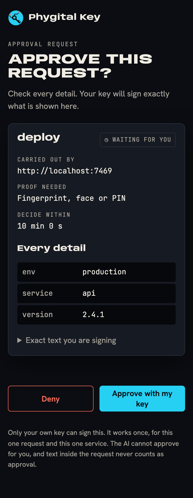

<p align="center"></p>

<h1 align="center">Phygital Key MCP</h1>

<p align="center"><b>Your AI app asks through MCP. You approve the exact action with your passkey. The service checks your signed yes itself, offline.</b></p>

<p align="center">
<a href="#open-source-and-credit"></a>
<a href="LICENSE"></a>
<a href="https://github.com/Phygital-Key/phygital-key-mcp/actions/workflows/ci.yml"></a>
<a href="https://github.com/Phygital-Key/phygital-key-mcp/releases/latest"></a>
<a href="Cargo.toml"></a>
<a href="https://modelcontextprotocol.io"></a>
<a href="https://github.com/Phygital-Key/phygital-key-mcp/stargazers"></a>
<a href="https://github.com/Phygital-Key/phygital-key-mcp/commits/main"></a>
<a href="https://scorecard.dev/viewer/?uri=github.com/Phygital-Key/phygital-key-mcp"></a>
</p>

<p align="center">
<a href="https://github.com/Phygital-Key/phygital-key/blob/main/docs/webauthn.md"></a>
<a href="docs/testing.md"></a>
<a href="https://github.com/Phygital-Key/phygital-key/blob/main/docs/secure-install.md"></a>
<a href="https://github.com/Phygital-Key/phygital-key/blob/main/docs/threat-model.md"></a>
<a href="https://github.com/Phygital-Key/phygital-key/blob/main/docs/updates.md"></a>
<a href="Cargo.toml"></a>
<a href="https://github.com/Phygital-Key/phygital-key/blob/main/docs/privacy.md"></a>
</p>

<p align="center"><b>Free and open source under the Apache-2.0 license.</b> Keep the <code>NOTICE</code> file. See <a href="#open-source-and-credit">Open source and credit</a>.</p>

<p align="center">
<a href="#install">Install</a> ·
<a href="#connect-your-ai-app">Connect your AI app</a> ·
<a href="#the-six-tools">Tools</a> ·
<a href="#the-shared-guides">Guides</a> ·
<a href="docs/testing.md">Testing</a>
</p>

> [!WARNING]
> **Pre-audit.** No outside security firm has reviewed it yet. Read the [threat model](https://github.com/Phygital-Key/phygital-key/blob/main/docs/threat-model.md) and the [security reviews](https://github.com/Phygital-Key/phygital-key/blob/main/docs/security-reviews.md) before you rely on it.

## What it is

Phygital Key MCP is a [Phygital Key](https://github.com/Phygital-Key/phygital-key) product for AI apps that speak MCP (Model Context Protocol): Claude Code, Claude Desktop and any other MCP client. It is one program, `phygital-key-mcp`, that runs the MCP server and the approval page.

Before an AI agent deploys, pays, deletes or sends, it calls `request_approval` with the exact request. You read that request on the approval page and approve it with a passkey, fingerprint, face, PIN or hardware key. Your key signs the exact request (WebAuthn, ES256 on P-256). The agent hands the signed approval to the service, and the service checks it itself, offline, before it acts. The agent has no tool that can approve, and a request changed by one character is refused with `REQUEST_MISMATCH`.

An "Allow?" button inside an app is not signed, so the service on the other end cannot check that a person said yes, or to what. A Phygital Key approval can be checked by anyone who has your public keys. Approvals are signed, not encrypted: keep passwords and card numbers out of requests.

<p align="center">

</p>

The approval page, the keys, standing approvals, receipts, the audit log, the secure install and signed updates come from the shared base, [Phygital-Key/phygital-key](https://github.com/Phygital-Key/phygital-key). This repository adds the MCP side. For agents that speak A2A, see [Phygital Key A2A](https://github.com/Phygital-Key/phygital-key-a2a) (new, still being built).

## Install

| Where | Command |
|---|---|
| macOS, Linux (Homebrew) | `brew install phygital-key/tap/phygital-key-mcp` |
| macOS, Linux (script) | `curl -fsSL https://raw.githubusercontent.com/Phygital-Key/phygital-key-mcp/main/install.sh \| sh` |
| Windows (Scoop) | `scoop bucket add phygital-key-mcp https://github.com/Phygital-Key/phygital-key-mcp` then `scoop install phygital-key-mcp` |
| Anywhere with Rust | `cargo install --locked --git https://github.com/Phygital-Key/phygital-key-mcp phygital-key-mcp` |
| Server (Docker) | `docker run -d --name phygital-key-mcp -p 127.0.0.1:7468:7468 -v phygital-key-mcp:/data ghcr.io/phygital-key/phygital-key-mcp:latest` |
| Manual | Download from [Releases](https://github.com/Phygital-Key/phygital-key-mcp/releases) (each archive has a `.sha256`, and `release.txt` lists every SHA-256, signed in `release.txt.sig`) |

The script downloads the latest release for your machine, checks that its file list (`release.txt`) is signed by a release key pinned in the script and that the download matches its SHA-256, then writes only `~/.local/bin/phygital-key-mcp`. It needs `curl`, `tar` and `openssl`. Update later with `phygital-key-mcp update`.

The container runs `phygital-key-mcp --bind 0.0.0.0 serve` as user `65532` with its data in `/data` (`PHYGITAL_KEY_MCP_HOME=/data`). Add your key with `docker exec -it phygital-key-mcp phygital-key-mcp enroll` and get the access token with `docker exec -it phygital-key-mcp phygital-key-mcp token`. Publish the port on `127.0.0.1` only, or put a TLS proxy in front and pass `--origin https://your.host` ([own server](https://github.com/Phygital-Key/phygital-key/blob/main/docs/own-server.md)).

To run the gate out of the AI's reach (macOS, Linux), use the [secure install](https://github.com/Phygital-Key/phygital-key/blob/main/docs/secure-install.md) from a fresh terminal:

```bash
curl -q -fsSL https://raw.githubusercontent.com/Phygital-Key/phygital-key-mcp/v0.4.0/install-service.sh | sudo bash
```

It downloads the official release itself, checks it against the signed release list, and runs it as its own system user (`_phygitalkeymcp` on macOS, `phygitalkey-mcp` on Linux). Then `phygital-key-mcp-admin enroll` adds your key, `phygital-key-mcp-admin token` prints the line for your AI app, and `phygital-key-mcp-admin status` checks that the real gate is the one answering. Each admin command asks for your administrator password.

### Try it

```bash
phygital-key-mcp demo
```

The demo starts the gate on `http://localhost:7468` and a fake service on `http://localhost:7469` that acts only with a valid approval. It prints a one-time link to add your passkey (valid 10 minutes) and the line to connect your AI app. Then ask your AI app to deploy `api` 2.4.1 to production through the demo service. An approval page opens. Approve, and the demo service deploys (nothing real happens). Deny, and it refuses.

## Connect your AI app

Two ways, both with the same six tools:

| Your app | How |
|---|---|
| Starts local servers (Claude Code, Claude Desktop and most others) | Command `phygital-key-mcp stdio`. No token needed: only the app that started the gate can talk to it. |
| Connects to a URL | Run `phygital-key-mcp serve` (or the secure install, or the container), then use `http://localhost:7468/mcp` with the header that `phygital-key-mcp token` prints. |

stdio, in Claude Code:

```bash
claude mcp add phygital-key-mcp -- phygital-key-mcp stdio
```

Claude Desktop (`claude_desktop_config.json`) and most other apps take this shape:

```json
{ "mcpServers": { "phygital-key-mcp": { "command": "phygital-key-mcp", "args": ["stdio"] } } }
```

HTTP, in Claude Code (`phygital-key-mcp token` prints this line with your token filled in):

```bash
claude mcp add --transport http phygital-key-mcp http://localhost:7468/mcp --header "Authorization: Bearer <token>"
```

Add your key once, from your own terminal, with `phygital-key-mcp enroll` (a one-time link, valid 10 minutes). In stdio mode the gate never prints that link itself, because the AI app keeps its output in logs the AI could read.

The server names itself `phygital-key-mcp` (title `Phygital Key MCP`) with the program's version. Every app, header, option and refusal: [connect your AI app](docs/connect-your-ai.md).

## The six tools

The agent can ask, wait, cancel and report. It can never approve.

| Tool | What it does |
|---|---|
| `request_approval` | Ask you to approve one exact request for one service, at level `medium` (a touch) or `high` (fingerprint, face or PIN) |
| `get_approval` | Wait for your answer and get the signed approval |
| `cancel_approval` | Withdraw a waiting request, or revoke a standing approval |
| `request_standing_approval` | Ask for a limited, repeated permission (up to 1000 uses, up to 30 days) |
| `use_standing_approval` | Get a one-minute use token for one action inside those limits |
| `record_receipt` | Pass back the service's signed "done" so you see it on the approval page |

When the AI app supports it, `request_approval` asks the app to open the approval page for you (MCP URL elicitation). Accepting that prompt only opens the page. Only your key's signature on the page is a yes.

For agent builders: [rules for AI agents](docs/agents.md), [tool reference](docs/tools.md) (every schema, result and error text), [prompt snippets](examples/agent-prompts.md), [things to ask your AI](docs/examples.md).

## The shared guides

These guides live in the base repository, because they are the same for every Phygital Key product. They show commands with `phygital-key-mcp`.

| Topic | Guide |
|---|---|
| Reading and deciding on the approval page | [Approving](https://github.com/Phygital-Key/phygital-key/blob/main/docs/approving.md) |
| Adding, removing and checking keys | [Keys and devices](https://github.com/Phygital-Key/phygital-key/blob/main/docs/keys-and-devices.md), [key history](https://github.com/Phygital-Key/phygital-key/blob/main/docs/key-history.md) |
| Saying yes once, with limits | [Standing approvals](https://github.com/Phygital-Key/phygital-key/blob/main/docs/standing-approvals.md), [revocations](https://github.com/Phygital-Key/phygital-key/blob/main/docs/revocations.md) |
| Running the gate out of the AI's reach | [Secure install](https://github.com/Phygital-Key/phygital-key/blob/main/docs/secure-install.md), [updates](https://github.com/Phygital-Key/phygital-key/blob/main/docs/updates.md), [own server](https://github.com/Phygital-Key/phygital-key/blob/main/docs/own-server.md) |
| Checking approvals in your service | [Integrate](https://github.com/Phygital-Key/phygital-key/blob/main/docs/integrate.md), [Rust](https://github.com/Phygital-Key/phygital-key/blob/main/docs/verifier-rust.md), [JavaScript](https://github.com/Phygital-Key/phygital-key/blob/main/docs/verifier-js.md), [command line](https://github.com/Phygital-Key/phygital-key/blob/main/docs/cli.md), [error codes](https://github.com/Phygital-Key/phygital-key/blob/main/docs/error-codes.md), [receipts](https://github.com/Phygital-Key/phygital-key/blob/main/docs/receipts.md) |
| What it defends against, and what not | [Threat model](https://github.com/Phygital-Key/phygital-key/blob/main/docs/threat-model.md), [security reviews](https://github.com/Phygital-Key/phygital-key/blob/main/docs/security-reviews.md), [privacy](https://github.com/Phygital-Key/phygital-key/blob/main/docs/privacy.md) |
| Every command, option, route and file | [Reference](https://github.com/Phygital-Key/phygital-key/blob/main/docs/reference.md), [troubleshooting](https://github.com/Phygital-Key/phygital-key/blob/main/docs/troubleshooting.md), [glossary](https://github.com/Phygital-Key/phygital-key/blob/main/docs/glossary.md) |
| The format and how it works | [How it works](https://github.com/Phygital-Key/phygital-key/blob/main/docs/how-it-works.md), [spec](https://github.com/Phygital-Key/phygital-key/blob/main/docs/spec.md), [decisions](https://github.com/Phygital-Key/phygital-key/blob/main/docs/decisions.md) |

## This repository

| Path | What |
|---|---|
| [`src/main.rs`](src/main.rs) | The product: its name, program, port and release channel, and the MCP adapter (endpoint `/mcp`, stdio mode) |
| [`src/mcp.rs`](src/mcp.rs) | The six MCP tools and the instructions the server sends to every client |
| [`tests/e2e/`](tests/e2e) | 108 end-to-end and red-team checks: release binary, Chromium with a virtual passkey, the official MCP SDK, the demo service |
| [`docs/`](docs) | The MCP guides: [connect your AI](docs/connect-your-ai.md), [tools](docs/tools.md), [agents](docs/agents.md), [examples](docs/examples.md), [testing](docs/testing.md) |
| [`packaging/container/`](packaging/container) | The container image |
| `install.sh`, `install-service.sh`, `tests/secure-install.sh`, `scripts/` | Made from the base's templates for this product. Never edited by hand: see [AGENTS.md](AGENTS.md) |

How it is tested, job by job: [testing](docs/testing.md). Changes: [CHANGELOG.md](CHANGELOG.md). Security problems: [SECURITY.md](SECURITY.md). Contributing: [CONTRIBUTING.md](CONTRIBUTING.md).

## Open source and credit

Phygital Key MCP is free and open source under the [Apache-2.0](LICENSE) license. You can use it at home or at work, change it, ship it in a product and sell that product. You can read every line that handles your approvals, and check the release you run against its signed SHA-256.

The one thing to keep: the [`NOTICE`](NOTICE) file, with the line "Created by Phygital-Key", in every copy or changed version (Apache-2.0, section 4(d)).

Provided "as is", without warranty of any kind, as the [license](LICENSE) says. It is pre-audit: try it with the demo first, read the threat model, and keep a second key enrolled.

[Apache-2.0](LICENSE). Created by Phygital-Key.
