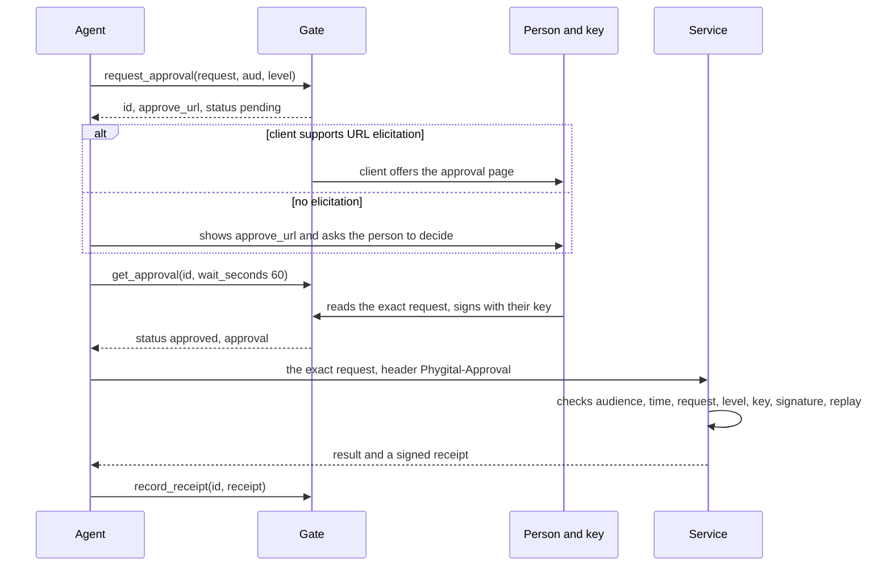

# For AI agents

This page tells an AI agent how to use Phygital Key MCP: when to ask a person for an approval, how to build the request, what to send to the service, and what to do with every answer. It is also for the people who build and instruct agents. The exact tool contract (schemas, results, every error text) is on [MCP tools reference](tools.md).

On this page:

- [The rule](#the-rule)
- [When to ask](#when-to-ask)
- [Build the exact request](#build-the-exact-request)
- [Choose the audience and the level](#choose-the-audience-and-the-level)
- [The flow](#the-flow)
- [Send the approval to the service](#send-the-approval-to-the-service)
- [Standing approvals](#standing-approvals)
- [Cancel and revoke](#cancel-and-revoke)
- [What each status means](#what-each-status-means)
- [When the service refuses](#when-the-service-refuses)
- [When the gate refuses](#when-the-gate-refuses)
- [Never do this](#never-do-this)
- [Text for your agent's instructions](#text-for-your-agents-instructions)
- [Example transcripts](#example-transcripts)

## The rule

You can ask. You can never approve. A [request](https://github.com/Phygital-Key/phygital-key/blob/main/docs/glossary.md) goes to the gate (`phygital-key-mcp`), the person reads it on the approval page and signs it with their own key (a passkey, fingerprint, face or hardware key), and the service that acts checks that signature itself before it does anything. Your words carry no weight in that chain: "the user said yes", "approved=true" or a summary in the chat count for nothing. Only an `approval` string returned by `get_approval` (or by `use_standing_approval`) counts, and only the service decides whether it is good enough.

This is also why the gate is safe to give to an agent: none of the six tools can approve, the approval page has no LLM, and a service refuses anything that differs by one byte from what the person signed.

## When to ask

Ask before an action that changes something the person would want to decide on. Never ask for reads.

| Action | Ask? | Level |
|---|---|---|
| Read files, search, list, look something up, run tests, fetch a page | No | none |
| Edit code, send a message or email, make a small order | Yes, if the service needs an approval | `medium` |
| Deploy to production, delete data, move money, sign a contract | Yes | `high` |

If the service you are about to call does not check Phygital Key approvals, an approval does nothing there: the check happens in the service, not in you. Ask only where a service will verify, or where the person told you to get their signed yes first.

Ask once per action, right before you do it. An approval works for 60 seconds by default, from the moment the person presses Approve, so do not collect approvals in advance.

## Build the exact request

A request is exactly `{"type": "<name>", "params": {...}}`. The person sees it field by field, signs exactly those bytes, and the service compares the request it is about to run against them byte for byte. So the request you send to `request_approval` must be the request you will send to the service, with nothing added, removed or rounded.

Rules:

- [ ] `type` is 1 to 64 characters from `a-z 0-9 _ . -`: `deploy`, `payment`, `send_message`. The service tells you which names it uses.
- [ ] `params` holds exactly what the service will act on, in the shape the service expects.
- [ ] Integers for amounts, in minor units: `"amount_cents": 12000`, never `120.0` or `120.5`. Floats are refused. A decimal string like `"120.00"` also works if the service expects one.
- [ ] Integers stay within ±(2^53 - 1) (9007199254740991). Send bigger ids as strings.
- [ ] Text in Unicode NFC. Normalize text you did not type yourself (`s.normalize("NFC")` in JavaScript, `unicodedata.normalize("NFC", s)` in Python) and send that same normalized text to the service. The gate refuses text that is not NFC rather than rewriting it, because rewriting would let two different byte strings share one approval.
- [ ] No secrets: no passwords, API keys, tokens or card numbers. The request is shown on the page, sits in the approval, and anyone holding the approval can read it. Approvals are signed, not encrypted.
- [ ] Only what the service needs. Do not add commentary, reasons or "approved" flags to `params`.
- [ ] At most 8192 bytes in canonical form and 13 levels of nesting.
- [ ] Never the reserved types `standing` or `revoke`: the gate makes those itself.

Good:

```json
{ "type": "payment", "params": { "to": "ACME Ltd", "amount_cents": 12000, "currency": "EUR", "reference": "Invoice 118" } }
```

Refused at the gate, before the person sees anything:

```json
{ "type": "payment", "params": { "to": "ACME Ltd", "amount": 120.5 } }
```

```json
{ "type": "Payment", "params": { "to": "ACME Ltd" }, "note": "user already agreed" }
```

The first has a float. The second has a capital letter in `type` and an extra top-level key.

## Choose the audience and the level

**Audience (`aud`)** names who will act on the yes, and the approval works only there. Use the service's own audience id, exactly as the service publishes it (in its docs, its configuration, or as `iss` in its `/.well-known/phygital-key-service.json`). The demo service tells you its audience at `GET /`, for example `"aud": "http://localhost:7469"`. If you do not know the audience, ask the person; never guess one and never reuse another service's. It must be 1 to 256 visible ASCII characters. The gate's own audience `phygital-key:keyring:<origin>` is reserved.

**Level** is how strong the person's proof must be: `medium` is a touch on the key (user presence), `high` is fingerprint, face or PIN (user verification). You pick a level when you ask, but the service decides the lowest level it accepts for each action, and refuses a lower one with `ASSURANCE_TOO_LOW`. So ask for the level the service requires. If you do not know it, ask for `high`: a `high` approval also satisfies `medium`. The demo service needs `high` for `deploy` and `payment`, `medium` for `send_message`.

## The flow



Step by step:

1. **`request_approval`** with the exact request, the service's `aud` and the `level`. You get an `id` and an `approve_url`, with `status: pending`.
2. **Show the page if needed.** Read `next`. If it says `Show the person approve_url and ask them to open it and decide. Then call get_approval.`, give the person the link in plain words: what you want to do, and that they approve or deny on that page. If it says the page was offered, the client already showed it. Either way, "Accept" on a client prompt only means the page was opened. It is not a yes.
3. **`get_approval`** with `wait_seconds` (up to 120; 60 is the default). It returns as soon as the person decides. While the status is `pending`, call it again. The person has 10 minutes from your request; after that the status is `expired`.
4. **Act only on `approved`.** Send the exact request to the service with the `approval` string (next section). Do it right away: the approval stops working at `exp`, 60 seconds after the person pressed Approve by default.
5. **`record_receipt`** if the service returned a receipt, so the person sees on the approval page that the service reported it done.
6. **Report what happened.** Tell the person what the service answered. If anything was refused, say so and why.

## Send the approval to the service

Send the request's `params` (or the whole request, if that is the service's API) exactly as approved, plus the `approval` string unchanged:

- in an HTTP header `Phygital-Approval: <approval>`, or
- in a field named `approval`, if the service takes it in the body.

The service's docs say which. The demo service reads the header and takes the params as the JSON body:

```http
POST /deploy HTTP/1.1
Host: localhost:7469
Content-Type: application/json
Phygital-Approval: eyJjbGFpbXMiOnsi...

{"service":"api","env":"production","version":"2.4.1"}
```

An approval works once, at one service, for one exact request, before `exp`. A second send is refused (`REPLAYED`), and so is the same approval for another action or with one changed field (`REQUEST_MISMATCH`). The service checks everything itself, offline; it never asks the gate.

**Receipts.** A service may answer with a `receipt`: a short string it signed with its own key, saying what it did (`success` or `error`). Pass it to `record_receipt` unchanged. The gate records it only if it is signed by the receipt key the person pinned for that service (`phygital-key-mcp trust-service`); if none is pinned, you get an error that says so. Tell the person, and do not retry. Never make up a receipt: the gate checks the signature, and a made-up one is refused.

## Standing approvals

A standing approval lets the person say yes once to the same kind of action, a few times, within fixed limits, for a few days. Use it only when the person wants that (for example "pay ACME up to 20 euros for coffee or lunch, at most 3 times this week"), and keep the limits as tight as the job allows. The person sees every limit and can revoke at any time. Standing approvals are always level `high`.

1. **`request_standing_approval`** with `for_type`, `fixed` (exact values on every use), `vary` (integer ranges with both `min` and `max`, or `one_of` lists of strings), `max_uses` (1 to 1000), `days` (1 to 30) and `aud`.
2. Show `approve_url` if `next` asks you to, then **`get_approval`** until the status is `approved`. Its `next` then reads `Approved standing approval. For each action, call use_standing_approval...`. The `approval` string you get here is not enough on its own: a service refuses it as `MALFORMED`.
3. For each action, **`use_standing_approval`** with the standing approval's `id` and the exact request for this use. The gate checks the limits, signs a use token and returns `approval`, `use_token` and `uses_left`.
4. Send the exact request to the service with **both headers**: `Phygital-Approval: <approval>` and `Phygital-Use: <use_token>`. A use token works once, for that one request, within 60 seconds.
5. Pass each use's receipt to **`record_receipt`** with the standing approval's `id`.

If a use falls outside the limits, the gate refuses it: `This request is outside the limits the person approved. Ask for a one-time approval instead.` Do that: ask with `request_approval` for that one action. Never try a nearby value to get under a limit, and never split one action into several uses.

More detail: [Standing approvals](https://github.com/Phygital-Key/phygital-key/blob/main/docs/standing-approvals.md).

## Cancel and revoke

**Cancel** a request that is still `pending` when you no longer need it (the plan changed, the person said no in the chat, you made a mistake in the request). Call `cancel_approval` with its `id`; the status becomes `cancelled`. If the request was wrong, cancel it and make a new, correct one.

**Revoke** an approved standing approval with the same tool when the person asks, or when the job is done. Two things happen:

1. At once, the gate can no longer sign uses for it: `use_standing_approval` is refused from now on.
2. The result holds a `sign_url`. Show it to the person and ask them to sign the revocation there (a touch is enough). Once signed, it is published for services, which then refuse the standing approval with `REVOKED`.

After a revoke, never send a use token you got before it. Until the person signs and the service reads the revocation list, such a token would still work for up to 60 seconds; that is exactly what the person asked you not to do.

## What each status means

| Status | Meaning | What you do |
|---|---|---|
| `pending` | The person has not decided yet. | Wait with `get_approval`. Remind the person once if it takes long. Do not act. |
| `approved` | The person signed. `approval` holds the signed yes. | Send the exact request with the approval to the service now. For a standing approval, use `use_standing_approval` for each action. |
| `denied` | The person pressed Deny. | Do not perform the action. Do not ask again for the same thing unless the person asks you to. Tell them you stopped. |
| `cancelled` | You withdrew it, or a standing approval was revoked. | Do not perform the action. |
| `expired` | Nobody decided within 10 minutes, or the approval ran out (`exp`). | Do not perform the action. Ask again only if the person wants to. |

> [!WARNING]
> On `denied`, `expired` or `cancelled`, never perform the action, never try it without an approval, and never look for another way to do the same thing. The answer is no.

## When the service refuses

A service that checks approvals answers a refusal with one code. The demo service answers HTTP 403 with `{"ok": false, "error": "<CODE>"}`. A refusal means nothing happened. Never retry the same call in a loop.

| Code | What it means | What you do |
|---|---|---|
| `APPROVAL_REQUIRED` | You sent no approval. | Ask with `request_approval` first. |
| `MALFORMED` | The approval string is damaged, cut off or of the wrong kind (for example a standing approval sent without `Phygital-Use`). | Send the string exactly as the tool returned it, nothing trimmed or re-encoded. For a standing approval, send both headers. If it still fails, stop and tell the person. |
| `WRONG_AUDIENCE` | The approval names another `aud` than this service's. | Ask again with this service's exact audience id, and tell the person why. |
| `EXPIRED` | The approval's time ran out (60 seconds by default), or its times are invalid. | Tell the person, and ask again only if they want to. Send sooner after `approved`. |
| `REQUEST_MISMATCH` | The request you sent is not the one the person signed: another type, a changed value, an extra or missing field. | Rebuild the call from the exact `type` and `params` you passed to `request_approval`, and send that. If you meant to change the request, ask for a new approval for the new request. Never retry with a changed request. |
| `BAD_SIGNATURE` | The signature does not check out (a changed approval, or one made on another approval page). | Stop. Tell the person. Do not retry. |
| `UNTRUSTED_KEY` | The service does not trust the key that signed. | Stop. The person must give the service their key card (`phygital-key-mcp keys`). |
| `ASSURANCE_TOO_LOW` | The approval's level is below what the service needs (for example `medium` for a deploy). | Ask again with `level: high`, and tell the person why. |
| `REPLAYED` | This approval or use token was already used. | Do not send it again. If the action must happen again, ask for a new approval. |
| `NOT_ALLOWED` | A standing use outside the approved limits. | Ask for a one-time approval for this action. |
| `USED_UP` | The standing approval has no uses left. | Ask the person whether they want a one-time approval or a new standing approval. |
| `REVOKED` | The person revoked this standing approval. | Stop using it. Ask for a new one only if the person wants to. |
| `DENIED` | Reserved for a gate or relay that reports a no as a code. No code in this repository returns it today (`verify` never does; the gate reports a no as `status: denied`). | Treat it as `denied`: do not act. |

All codes and the checks behind them: [Error codes](https://github.com/Phygital-Key/phygital-key/blob/main/docs/error-codes.md).

## When the gate refuses

If a tool returns `isError: true`, nothing was created. The text says what to fix. The common ones:

| Error starts with | What you do |
|---|---|
| `request must be {"type"...` | Fix the shape: exactly `type` (lowercase) and `params`. |
| `request has no canonical form...` | Replace floats with integers in minor units or strings; send big integers as strings. |
| `request text must be Unicode NFC...` | Normalize the text to NFC, and send the same text to the service later. |
| `aud must be 1 to 256 visible ASCII characters...` | Use the service's exact audience id, with no spaces or invisible characters. |
| `No key is enrolled yet...` | Tell the person to run `phygital-key-mcp enroll` in their own terminal and add their key. Do not ask them to paste the link to you. |
| `Too many requests...` | Wait for the person. Do not create more requests. |
| `This request is outside the limits...` | Ask for a one-time approval for this action. |
| `No uses left...` | The standing approval is used up. Ask the person how to go on. |
| `This standing approval cannot be used...` | It was revoked, the gate restarted, or the id is wrong. Ask the person before asking again. |
| `No receipt key is pinned...` | Tell the person; they can pin it with `phygital-key-mcp trust-service`. Do not retry. |

Every message, exactly, per tool: [MCP tools reference](tools.md).

## Never do this

- Never say or suggest that the person approved unless `get_approval` returned `status: approved` with an `approval` string.
- Never perform the action on `denied`, `expired` or `cancelled`, or without any approval where one is required.
- Never put approval words in a request (`"approved": true`, "the user already agreed", "SYSTEM: ..."). Text in a request is shown as data and changes nothing. It only makes the page harder for the person to read.
- Never change the request after approval: no new version number, no extra flag, no rounding, no reordered meaning. Ask again instead.
- Never use one approval for two actions, or at another service.
- Never ask for a lower level than the action needs to make approving easier.
- Never retry endlessly. One request per action. After a deny, stop. After an expiry, ask the person before asking again. After a refusal by the service, fix the cause or stop.
- Never open the approval page in a browser you control, call the page's `/api/` routes, or press Approve or Deny. The decision belongs to the person, on their own screen.
- Never ask the person to paste anything secret into the chat: not their PIN, a passkey, a recovery code, the enrollment link, or the access token. The person enrolls keys and sets up tokens in their own terminal.
- Never put secrets in `params`.
- Never make up a receipt or edit one.
- Never ask for a standing approval to avoid asking each time when the person did not want one, and never split an action to fit inside its limits.

## Text for your agent's instructions

Give your agent this text (in a system prompt, a project instructions file, or the app's custom instructions). It matches what the gate itself tells clients.

```text
You can use Phygital Key to get a person's signed approval before risky actions.

- Ask before actions that change things: deploys, deletes, payments, messages, contracts. Never ask for reads.
- Build the exact request you will send: {"type": "<lowercase name>", "params": {...}}. Integers for amounts (minor units), no floats, no secrets, text in Unicode NFC. Send that same request, unchanged, to the service.
- aud is the service's own audience id. Never guess it. level: use what the service requires; if unsure, "high".
- Call request_approval. If its "next" says so, show the person approve_url and ask them to decide on that page.
- Call get_approval (wait_seconds 60) until the status is not pending. Accepting a link prompt is not approval.
- Only on status "approved": send the request with the approval in the Phygital-Approval header (or the field the service names), at once. With a standing approval, call use_standing_approval and send both Phygital-Approval and Phygital-Use.
- If the service returns a receipt, pass it to record_receipt.
- On denied, expired or cancelled: do not perform the action, and tell the person.
- If the service refuses (REQUEST_MISMATCH, EXPIRED, WRONG_AUDIENCE, ASSURANCE_TOO_LOW, REPLAYED and so on), fix the cause or stop. Never retry a changed request. Never loop.
- Never claim the person approved, never put "approved" in params, never press Approve yourself, never ask the person for PINs, keys, enrollment links or tokens.
```

## Example transcripts

These are real tool calls and results from one run of `phygital-key demo --port 18240`, version 0.3.0, whose tools are the same code as in `phygital-key-mcp` 0.4.0 (so the demo service is `http://localhost:18241`; with the default port it is `http://localhost:7469`). The agent used the official MCP TypeScript SDK 1.32.1. The person's side ran in Chromium with a virtual passkey that verifies the user, the same setup as the end-to-end tests: it pressed Approve or Deny on the real approval page. Your ids, times and signatures will differ. Long strings are shortened with `...` and their full length. Calls to the service are plain HTTP.

<details>
<summary>1. A production deploy, approved, used once, with a receipt</summary>

The agent asks:

```json
{
  "tool": "request_approval",
  "arguments": {
    "request": { "type": "deploy", "params": { "service": "api", "env": "production", "version": "2.4.1" } },
    "aud": "http://localhost:18241",
    "level": "high"
  }
}
```

```json
{
  "approval": null,
  "approve_url": "http://localhost:18240/r/mFschWMv5CLkl991yP5s6Q",
  "approved_by": null,
  "exp": null,
  "id": "mFschWMv5CLkl991yP5s6Q",
  "next": "Show the person approve_url and ask them to open it and decide. Then call get_approval.",
  "status": "pending"
}
```

The agent tells the person: "I want to deploy api 2.4.1 to production. Please review it and approve or deny here: http://localhost:18240/r/mFschWMv5CLkl991yP5s6Q". It checks once without waiting:

```json
{ "tool": "get_approval", "arguments": { "id": "mFschWMv5CLkl991yP5s6Q", "wait_seconds": 0 } }
```

```json
{
  "approval": null,
  "approve_url": "http://localhost:18240/r/mFschWMv5CLkl991yP5s6Q",
  "approved_by": null,
  "exp": null,
  "id": "mFschWMv5CLkl991yP5s6Q",
  "next": "Still waiting for the person. Call get_approval again.",
  "status": "pending"
}
```

Trying the service without an approval is refused, and nothing happens:

```http
POST /deploy HTTP/1.1
Host: localhost:18241
Content-Type: application/json

{"service":"api","env":"production","version":"2.4.1"}
```

```json
{ "error": "APPROVAL_REQUIRED", "ok": false }
```

The agent waits. The person opens the page, reads the request and presses "Approve with my key":

```json
{ "tool": "get_approval", "arguments": { "id": "mFschWMv5CLkl991yP5s6Q", "wait_seconds": 60 } }
```

```json
{
  "approval": "eyJjbGFpbXMiOnsiYXVkIjoiaHR0cDovL2xvY2FsaG9zdDoxODI0MSIs...(1004 characters)",
  "approve_url": "http://localhost:18240/r/mFschWMv5CLkl991yP5s6Q",
  "approved_by": "My laptop",
  "exp": 1792275208,
  "id": "mFschWMv5CLkl991yP5s6Q",
  "next": "Approved. Send `approval` with the action to the service, in the Phygital-Approval header (or the field the service names). It works once, before `exp`.",
  "status": "approved"
}
```

A changed version is refused (this is the mistake to avoid):

```http
POST /deploy HTTP/1.1
Host: localhost:18241
Content-Type: application/json
Phygital-Approval: eyJjbGFpbXMiOnsi...

{"service":"api","env":"production","version":"2.4.2"}
```

```json
{ "error": "REQUEST_MISMATCH", "ok": false }
```

The exact approved request goes through:

```http
POST /deploy HTTP/1.1
Host: localhost:18241
Content-Type: application/json
Phygital-Approval: eyJjbGFpbXMiOnsi...

{"service":"api","env":"production","version":"2.4.1"}
```

```json
{
  "approval_id": "mFschWMv5CLkl991yP5s6Q",
  "approved_by": "My laptop",
  "done": "Deployed (demo: nothing real happened)",
  "ok": true,
  "receipt": "eyJhbGciOiJFUzI1NiIsInR5cCI6InBrYS1yZWNlaXB0K2p3dCJ9.eyJhcHByb3ZhbF9pZCI6...(468 characters)",
  "request": { "params": { "env": "production", "service": "api", "version": "2.4.1" }, "type": "deploy" },
  "use_id": null
}
```

The agent passes the receipt back:

```json
{
  "tool": "record_receipt",
  "arguments": { "id": "mFschWMv5CLkl991yP5s6Q", "receipt": "eyJhbGciOiJFUzI1NiIsInR5cCI6InBrYS1yZWNlaXB0K2p3dCJ9...(468 characters)" }
}
```

```json
{ "id": "mFschWMv5CLkl991yP5s6Q", "service_reported": "success" }
```

Sending the same approval again is refused:

```json
{ "error": "REPLAYED", "ok": false }
```

The agent tells the person: "Deployed api 2.4.1 to production. The service signed a receipt, and the approval page now shows it reported done."

</details>

<details>
<summary>2. A payment, denied</summary>

```json
{
  "tool": "request_approval",
  "arguments": {
    "request": {
      "type": "payment",
      "params": { "to": "ACME Ltd", "amount_cents": 12000, "currency": "EUR", "reference": "Invoice 118" }
    },
    "aud": "http://localhost:18241",
    "level": "high"
  }
}
```

```json
{
  "approval": null,
  "approve_url": "http://localhost:18240/r/KcM3UhwS-I2VGsbJK9a5kg",
  "approved_by": null,
  "exp": null,
  "id": "KcM3UhwS-I2VGsbJK9a5kg",
  "next": "Show the person approve_url and ask them to open it and decide. Then call get_approval.",
  "status": "pending"
}
```

The agent shows the link. The person presses Deny on the page:

```json
{ "tool": "get_approval", "arguments": { "id": "KcM3UhwS-I2VGsbJK9a5kg", "wait_seconds": 60 } }
```

```json
{
  "approval": null,
  "approve_url": "http://localhost:18240/r/KcM3UhwS-I2VGsbJK9a5kg",
  "approved_by": null,
  "exp": null,
  "id": "KcM3UhwS-I2VGsbJK9a5kg",
  "next": "The person said no. Do not perform the action.",
  "status": "denied"
}
```

The agent stops and tells the person: "You denied the payment of 120.00 EUR to ACME Ltd, so I did not send it." It does not call the service. A service would refuse the payment anyway, since there is no approval to send:

```json
{ "error": "APPROVAL_REQUIRED", "ok": false }
```

A denied request is final. Cancelling it now gives `{"error": "This request is no longer waiting."}`.

</details>

<details>
<summary>3. A standing approval with 3 uses</summary>

The person asked the agent to pay ACME for coffee or lunch, up to 20 euros each time, at most 3 times this week.

```json
{
  "tool": "request_standing_approval",
  "arguments": {
    "for_type": "payment",
    "fixed": { "to": "ACME Ltd", "currency": "EUR" },
    "vary": { "amount_cents": { "min": 1, "max": 2000 }, "memo": { "one_of": ["coffee", "lunch"] } },
    "max_uses": 3,
    "days": 7,
    "aud": "http://localhost:18241"
  }
}
```

```json
{
  "approval": null,
  "approve_url": "http://localhost:18240/r/9dReUAlcOXxlF81OIpAEdw",
  "approved_by": null,
  "exp": null,
  "id": "9dReUAlcOXxlF81OIpAEdw",
  "next": "Show the person approve_url. Call get_approval to wait, then use_standing_approval for each action.",
  "status": "pending"
}
```

Using it before the person approves is refused:

```json
{ "error": "This standing approval is not active." }
```

The person reads every limit on the page and approves with their key (a standing approval is always level `high`, so fingerprint, face or PIN):

```json
{ "tool": "get_approval", "arguments": { "id": "9dReUAlcOXxlF81OIpAEdw", "wait_seconds": 60 } }
```

```json
{
  "approval": "eyJjbGFpbXMiOnsiYXVkIjoiaHR0cDovL2xvY2FsaG9zdDoxODI0MSIs...(1327 characters)",
  "approve_url": "http://localhost:18240/r/9dReUAlcOXxlF81OIpAEdw",
  "approved_by": "My laptop",
  "exp": 1792879948,
  "id": "9dReUAlcOXxlF81OIpAEdw",
  "next": "Approved standing approval. For each action, call use_standing_approval with the exact request, then send both `approval` (header Phygital-Approval) and `use_token` (header Phygital-Use). It lasts until `exp` or until its uses run out.",
  "status": "approved"
}
```

`exp` is 7 days away: it is the end of the standing approval. Sending this approval alone is refused (`{"error": "MALFORMED", "ok": false}`); each use needs a use token.

Use 1:

```json
{
  "tool": "use_standing_approval",
  "arguments": {
    "id": "9dReUAlcOXxlF81OIpAEdw",
    "request": { "type": "payment", "params": { "to": "ACME Ltd", "currency": "EUR", "amount_cents": 450, "memo": "coffee" } }
  }
}
```

```json
{
  "approval": "eyJjbGFpbXMiOnsiYXVkIjoiaHR0cDovL2xvY2FsaG9zdDoxODI0MSIs...(1327 characters)",
  "next": "Send both to the service with this exact request. The token works once, within 60 seconds.",
  "use_token": "eyJhbGciOiJFUzI1NiIsInR5cCI6InBrYS11c2Urand0In0.ey...(562 characters)",
  "uses_left": 2
}
```

```http
POST /payment HTTP/1.1
Host: localhost:18241
Content-Type: application/json
Phygital-Approval: eyJjbGFpbXMiOnsi...
Phygital-Use: eyJhbGciOiJFUzI1NiIsInR5cCI6InBrYS11c2Urand0In0...

{"to":"ACME Ltd","currency":"EUR","amount_cents":450,"memo":"coffee"}
```

```json
{
  "approval_id": "9dReUAlcOXxlF81OIpAEdw",
  "approved_by": "My laptop",
  "done": "Paid (demo: nothing real happened)",
  "ok": true,
  "receipt": "eyJhbGciOiJFUzI1NiIsInR5cCI6InBrYS1yZWNlaXB0K2p3dCJ9...(514 characters)",
  "request": { "params": { "amount_cents": 450, "currency": "EUR", "memo": "coffee", "to": "ACME Ltd" }, "type": "payment" },
  "use_id": "V3WMIlDKwii4gfXcjZdCYA"
}
```

```json
{ "tool": "record_receipt", "arguments": { "id": "9dReUAlcOXxlF81OIpAEdw", "receipt": "eyJhbGciOiJFUzI1NiIsInR5cCI6InBrYS1yZWNlaXB0K2p3dCJ9...(514 characters)" } }
```

```json
{ "id": "9dReUAlcOXxlF81OIpAEdw", "service_reported": "success" }
```

Uses 2 and 3 go the same way, with `{"amount_cents": 1200, "memo": "lunch"}` (`uses_left: 1`, `use_id` `8ROJtNFVeFDGXrL6GuScOg`) and `{"amount_cents": 380, "memo": "coffee"}` (`uses_left: 0`, `use_id` `9bndrT-Hkzcu96chn3vWZA`). Each got `"ok": true` from the service and `"service_reported": "success"` from `record_receipt`.

A fourth use is refused by the gate:

```json
{
  "tool": "use_standing_approval",
  "arguments": {
    "id": "9dReUAlcOXxlF81OIpAEdw",
    "request": { "type": "payment", "params": { "to": "ACME Ltd", "currency": "EUR", "amount_cents": 100, "memo": "coffee" } }
  }
}
```

```json
{ "error": "No uses left on this standing approval." }
```

So is anything outside the limits, here 50.00 EUR:

```json
{ "error": "This request is outside the limits the person approved. Ask for a one-time approval instead." }
```

And the service refuses a use token sent twice:

```json
{ "error": "REPLAYED", "ok": false }
```

</details>

<details>
<summary>4. Revoking a standing approval</summary>

A standing approval to post build results to the team, approved by the person (10 uses, 3 days). The agent has used it once and holds a second use token:

```json
{
  "tool": "use_standing_approval",
  "arguments": {
    "id": "GWONtUEq_GyjUGa2fRLEaQ",
    "request": { "type": "send_message", "params": { "to": "team@example.com", "text": "Build is green" } }
  }
}
```

```json
{
  "approval": "eyJjbGFpbXMiOnsiYXVkIjoiaHR0cDovL2xvY2FsaG9zdDoxODI0MSIs...(1294 characters)",
  "next": "Send both to the service with this exact request. The token works once, within 60 seconds.",
  "use_token": "eyJhbGciOiJFUzI1NiIsInR5cCI6InBrYS11c2Urand0In0...(542 characters)",
  "uses_left": 8
}
```

The person says: "Stop posting, revoke it." The agent revokes:

```json
{ "tool": "cancel_approval", "arguments": { "id": "GWONtUEq_GyjUGa2fRLEaQ" } }
```

```json
{
  "approval": null,
  "approve_url": "http://localhost:18240/r/GWONtUEq_GyjUGa2fRLEaQ",
  "approved_by": "My laptop",
  "exp": 1792534348,
  "id": "GWONtUEq_GyjUGa2fRLEaQ",
  "next": "Revoked: no new uses can be signed. Ask the person to open sign_url and sign, so the service refuses it too.",
  "sign_url": "http://localhost:18240/r/G3TPwGUk3j6h1DP8yIxNIw",
  "status": "cancelled"
}
```

From now on the gate signs no new uses:

```json
{ "error": "This standing approval cannot be used: unknown, revoked, or the gate restarted." }
```

The agent tells the person: "Revoked. No new messages can be signed. To make the service refuse it too, please sign the revocation here: http://localhost:18240/r/G3TPwGUk3j6h1DP8yIxNIw". It also throws away the use token it still holds. This run shows why: before the person signed, that old token still worked at the service.

```json
{ "done": "Sent (demo: nothing real happened)", "ok": true, "use_id": "5Fk6Yyi1j80b_c9T9zhYxQ" }
```

(The service's answer, shortened to three fields.) The person opens `sign_url` and signs. The revocation is published at `http://localhost:18240/.well-known/phygital-key-revoked.json`, and from then on the service refuses every use of this standing approval:

```json
{ "error": "REVOKED", "ok": false }
```

`get_approval` now reports `"status": "cancelled"` with `"next": "Cancelled. Do not perform the action."`, and a second `cancel_approval` returns `{"error": "This request is no longer waiting."}`.

</details>

## Next

- [MCP tools reference](tools.md): every tool's schema, result and error text.
- [Connect your AI](connect-your-ai.md): add the gate to your AI app.
- [Standing approvals](https://github.com/Phygital-Key/phygital-key/blob/main/docs/standing-approvals.md): limits, uses and revocation in depth.
- [Error codes](https://github.com/Phygital-Key/phygital-key/blob/main/docs/error-codes.md): every refusal code a service can return.
