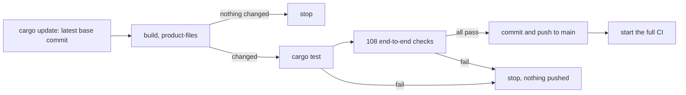

# Testing

How Phygital Key MCP is tested: the 108 end-to-end checks, the secure install test, the container check, the check that the generated files match the base, every CI job and the daily sync. It is for contributors and for anyone who wants to see what holds each guarantee. The engine's own tests (shared test vectors, property tests, fuzzing, mutation testing, the JavaScript checker, supply chain) run in the base: see [testing in the base](https://github.com/Phygital-Key/phygital-key/blob/main/docs/testing.md).

**On this page:** [at a glance](#at-a-glance) · [end-to-end checks](#end-to-end-and-red-team-checks) · [secure install](#secure-install-test) · [container](#container-check) · [generated files](#generated-files-check) · [CI](#ci) · [the sync](#the-daily-sync)

## At a glance

| Suite | What | Where it runs |
|---|---|---|
| End to end and red team | 108 checks: release binary, Chromium with a virtual passkey, the official MCP TypeScript SDK, the demo service | CI on every push and pull request; the daily sync |
| Secure install | 30 checks: installed for real as its own system user, then attacked as the user | CI, Linux and macOS |
| Container | builds the image, starts the gate, checks the user and enrollment | CI |
| Generated files | `product-files` output must equal the committed files | CI |
| Build and lint | `cargo fmt`, `cargo clippy`, `cargo test` (the product crate has no unit tests of its own today, so this builds and runs the doc and test targets; the engine's tests run in the base) | CI, Linux, macOS and Windows |

## End-to-end and red-team checks

`tests/e2e/run.mjs` uses real pieces only: the release binary, a real Chromium with a virtual passkey (Chrome DevTools WebAuthn), a real MCP client (the official TypeScript SDK, pinned in `tests/e2e/package-lock.json`) and the demo service, which verifies approvals the way a real service does.

```bash
cargo build --release --locked
cd tests/e2e && npm ci && npx playwright install chromium
PKA_BIN=../../target/release/phygital-key-mcp node run.mjs
```

It starts its own gate on port 17468 and the demo service on 17469 (and stdio gates on 17478 and 17488), in a temporary data folder. It prints one `PASS` or `FAIL` line per check and `108 passed, 0 failed` at the end, and exits non-zero on any failure.

The checks, grouped by theme (each name is the exact text the suite prints):

| Theme | Checks | What they prove |
|---|:-:|---|
| Before any key | 6 | The MCP endpoint refuses a missing or wrong access token; the server names itself `phygital-key-mcp` with its version; it lists exactly the 6 tools; requests are refused while no key is enrolled; enrollment needs the token from the command line. |
| Enrolling the first key | 6 | The token leaves the address bar; the first key is not trusted until it signs itself; the root fingerprint is shown; an enrollment link works once. |
| The normal flow | 15 | `request_approval` returns an id and link; the status is pending until the person acts; the service refuses without an approval; `get_approval` wakes up with the approval and the key's name; the service acts once and signs a receipt; the gate records only a receipt the service really signed, once; the page shows "the service reported: done"; a replay is refused. |
| What an agent might try | 16 | A changed version, another action and an extra field give `REQUEST_MISMATCH`; one changed character is refused; `medium` for a `high` action gives `ASSURANCE_TOO_LOW`; another audience gives `WRONG_AUDIENCE`; prompt injection in params changes nothing and is shown as plain data; a forged signature sent to the gate is refused; a deny reaches the agent with no approval and can never be approved later; cancel works. |
| Standing approvals | 26 | A range without a minimum and a disguised `standing` request are refused; no use before approval; the page states the limits, the end date, the use cap and the uses so far; uses inside the limits work and get receipts; a use token works once and only for its own request; over the limit, another payee and a third use of two are refused; a revoke stops new uses at once, the signed revocation is published, and then the service refuses with `REVOKED`. |
| Request rules | 7 | Floats, requests without `{type, params}`, a KELVIN SIGN look-alike (not NFC), an audience with invisible characters, the gate's own audience and too deep nesting are refused before the person sees anything; the claims cannot be swapped while the person signs. |
| Web protections | 9 | The MCP endpoint refuses calls from web pages; no CORS on localhost; a wrong `Host` (DNS rebinding) gets 421; a POST from another origin is refused; strict CSP; fonts served by the gate itself; nothing loaded from another site; `no-store` and `nosniff`. |
| Key changes | 13 | A second key is trusted only after the first key approves it; the signed key list checks out from the command line; a key slipped in without a signature, an older copy (rollback) and a list signed on another gate are caught; a removal needs approval, cannot be doubled, and the last key cannot be removed; key cards and history are published at `/.well-known`. |
| Command line and audit log | 4 | `verify` accepts a valid approval, refuses its second use and a changed request (exit code 1); the audit log chain is intact. |
| stdio mode | 4 | It stops cleanly on SIGTERM; it never prints an enrollment link; `request_approval` works and the approval page is served. |
| Flood limit | 2 | The 31st request in a minute is refused, and the gate still answers. |

## Secure install test

`tests/secure-install.sh` (generated from the base's template, see [AGENTS.md](../AGENTS.md#files-made-from-the-base)) installs the product for real as its own system user, with launchd on macOS and systemd on Linux, and then attacks it as the user. It needs password-less sudo, so it runs only in CI:

```bash
tests/secure-install.sh "$PWD/target/release/phygital-key-mcp"
```

Its 30 checks, in order:

- [x] It refuses a relative `--binary`, a binary the user could have changed, and an address another program holds.
- [x] The gate answers, and only the gate user listens (IPv4 and IPv6).
- [x] The program is owned by root; this user cannot change the program, read the data folder or write the keyring.
- [x] `phygital-key-mcp-admin status` confirms the listener, and the admin helper makes an enrollment link.
- [x] No enrollment link or token appears in the gate log.
- [x] The agent endpoint (`/mcp`) refuses calls without the token and accepts it, with `Bearer` in any case.
- [x] Installing again (an update) works; the daily update job is installed, owned by root, and on by default.
- [x] A release list signed by an unknown key is refused; the update job leaves the gate running unless a newer signed release exists, and records its result.
- [x] Root ignores the user's `~/.curlrc` and programs early in the user's `PATH`.
- [x] A failed update switches back to the previous program.
- [x] `--no-auto-update` removes the job, the choice is kept on later installs, and `--auto-update` turns it back on.
- [x] Uninstall stops it and keeps the keys; purge removes everything; uninstall removes the update job.

What the secure install does and refuses: [secure install](https://github.com/Phygital-Key/phygital-key/blob/main/docs/secure-install.md).

## Container check

The CI job `container image (build and start)` builds the image from `packaging/container` with the release binary for `linux/amd64`, then:

1. runs `--version` in it;
2. starts it on `127.0.0.1:7468` and waits for `/api/status` to answer;
3. checks that the image user is `65532:65532`;
4. runs `phygital-key-mcp enroll` inside and checks that it prints a `http://localhost:7468/enroll#token=` link.

The release workflow builds the published image `ghcr.io/phygital-key/phygital-key-mcp` for `linux/amd64` and `linux/arm64` from the signed release's own Linux archives.

## Generated files check

The CI job `files made from the base are up to date` builds the release binary, runs `target/release/phygital-key-mcp product-files --out .`, and fails on `git diff --exit-code`. It catches a hand edit to `install.sh`, `install-service.sh`, `tests/secure-install.sh`, `scripts/release-key.sh` or `scripts/package-manifests.sh`, and a version or base change without the files written again.

## CI

`.github/workflows/ci.yml` runs on every push to `main`, every pull request, and when the daily sync starts it. Third-party actions are pinned to a commit.

| Job | What it runs |
|---|---|
| test (Linux, macOS, Windows) | `cargo fmt --all --check`, `cargo clippy --all-targets --locked -- -D warnings`, `cargo test --locked` |
| files made from the base are up to date | `cargo build --release --locked`, `product-files --out .`, `git diff --exit-code` |
| end-to-end and red team | release build, Node 24, `npm ci --no-fund --no-audit`, `npx playwright install --with-deps chromium`, `node run.mjs` |
| secure install (Linux, macOS) | release build, `tests/secure-install.sh` with that binary |
| container image (build and start) | release build, `docker build`, the four steps above |

The release workflow (`.github/workflows/release.yml`, on a `v*` tag) also runs `cargo test --locked` on each of its 5 targets before it builds.

## The daily sync

`.github/workflows/sync-base.yml` runs every day at 05:23 UTC, and by hand:



A base change that breaks this product never lands here: the job stops before the commit. The full CI that follows adds Windows and macOS, the secure install and the container.

## Next

- [AGENTS.md](../AGENTS.md): layout, generated files and rules
- [Testing in the base](https://github.com/Phygital-Key/phygital-key/blob/main/docs/testing.md): vectors, property tests, fuzzing, mutation testing
- [Threat model](https://github.com/Phygital-Key/phygital-key/blob/main/docs/threat-model.md)
- [Tools](tools.md)
